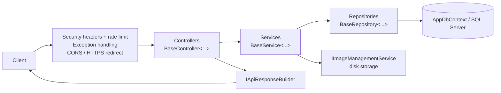
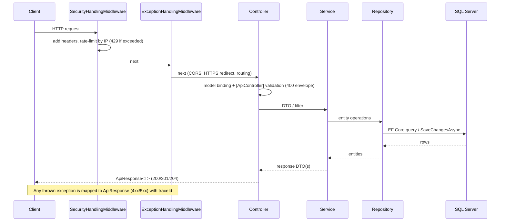
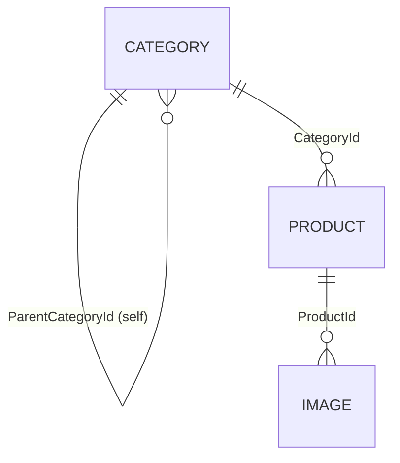
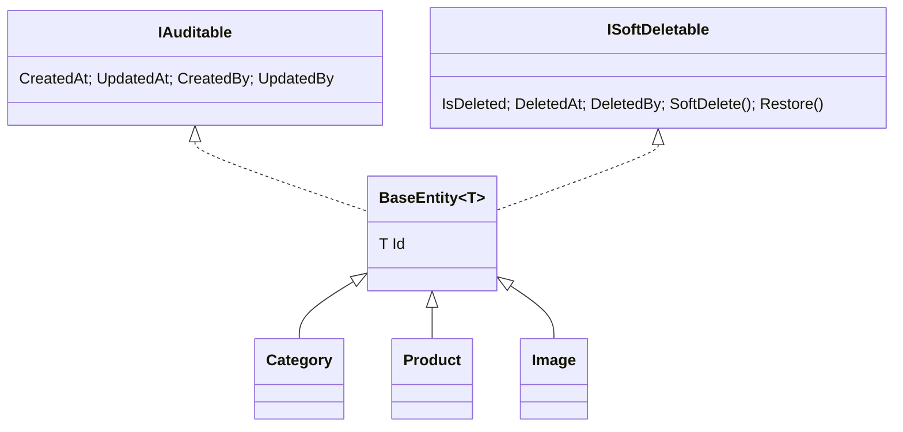

# Store API
 
A layered ASP.NET Core Web API for a product catalog: hierarchical **categories**, **products** with image uploads, soft deletion, paging/filtering/sorting, and a uniform JSON response envelope.


 
## Table of Contents
 
1. [Overview](#1-overview)
2. [Features](#2-features)
3. [Technology Stack](#3-technology-stack)
4. [Architecture](#4-architecture)
5. [Project Structure](#5-project-structure)
6. [Prerequisites](#6-prerequisites)
7. [Installation and Setup](#7-installation-and-setup)
8. [Environment Configuration](#8-environment-configuration)
9. [Development CLI](#9-development-cli)
10. [Database and Entity Framework Core](#10-database-and-entity-framework-core)
11. [Entity Design and Auditing](#11-entity-design-and-auditing)
12. [Soft Delete](#12-soft-delete)
13. [API Architecture and Endpoints](#13-api-architecture-and-endpoints)
14. [API Response Structure](#14-api-response-structure)
15. [Validation](#15-validation)
16. [Authentication and Authorization](#16-authentication-and-authorization)
17. [Error Handling and Logging](#17-error-handling-and-logging)
18. [VS Code Integration](#18-vs-code-integration)
19. [Common Development Workflows](#19-common-development-workflows)
20. [Troubleshooting](#20-troubleshooting)
21. [Production and Deployment](#21-production-and-deployment)
22. [Contribution Guidelines](#22-contribution-guidelines)
23. [Known Limitations and Inconsistencies](#23-known-limitations-and-inconsistencies)
---
 
## 1. Overview
 
**Store API** exposes REST endpoints for managing a product catalog.
 
- **Purpose:** CRUD for categories (unlimited-depth tree) and products (with up to N uploaded images), with soft delete/restore.
- **Approach:** layered architecture (API → Service → Repository → EF Core), generic base classes for controller/service/repository, DTO-based contracts, AutoMapper, and a centralized exception-to-response mapper.
- **Seed data:** a three-level category tree and sample products (see [Seeding](#seeding)).
## 2. Features
 
Implemented:
 
- ASP.NET Core Web API controllers (`CategoryController`, `ProductController`) on a generic `BaseController`.
- Generic service (`BaseService`) and repository (`BaseRepository`) with hooks for filtering, sorting, and includes.
- Repository pattern with `ICategoryRepository`, `IProductRepository`, `IImageRepository`.
- Standard response envelope (`ApiResponse<T>`) with pagination metadata and trace ID on errors.
- Centralized exception handling middleware mapping custom exceptions to HTTP status codes.
- DTO validation with Data Annotations plus a custom `[NotWhitespace]` attribute.
- Soft delete and restore through a global EF Core query filter.
- Audit columns on every entity (`CreatedAt`, `UpdatedAt`, `CreatedBy`, `UpdatedBy`, `DeletedAt`, `DeletedBy`) — see the [caveat](#23-known-limitations-and-inconsistencies).
- Hierarchical category delete/restore (cascades through subcategories).
- Product image upload to disk (extension, content-type, size, and count limits).
- Per-IP in-memory rate limiting and security response headers.
- Configurable CORS policy.
- Database seeding (`--seed`, and automatically in Development).
- `.env` loading through DotNetEnv.
**Not implemented:** authentication, authorization policies, JWT, roles, refresh tokens, Swagger/Scalar UI wiring, static file serving, tests.
 
## 3. Technology Stack
 
| Area | Technology | Version / Source |
|---|---|---|
| Language | C# (nullable + implicit usings enabled) | [`Directory.Build.props`](Directory.Build.props) |
| Runtime | .NET | `net10.0` |
| Web framework | ASP.NET Core (`Microsoft.NET.Sdk.Web`) | .NET 10 shared framework |
| ORM | Entity Framework Core | 10.0.14 |
| Database provider | `Microsoft.EntityFrameworkCore.SqlServer` | 10.0.14 |
| EF tooling | `EntityFrameworkCore.Design`, `EntityFrameworkCore.Tools` | 10.0.14 |
| Mapping | AutoMapper | 17.0.0 |
| Env loading | DotNetEnv | 3.2.0 |
| Authentication | None implemented | — |
| Validation | `System.ComponentModel.DataAnnotations` | built in |
| API docs packages | Swashbuckle.AspNetCore 11.0.1, Scalar.AspNetCore 3.0.1 | referenced, **not wired** in `Program.cs` |
| Other packages | `Microsoft.Extensions.FileProviders.Physical` 10.0.15, `Microsoft.AspNetCore.Http.Features` 5.0.17 (Core); `System.Security.Cryptography.Pkcs` 10.0.14 (Infrastructure) | csproj files |
| Build policy | `TreatWarningsAsErrors=true`, .NET analyzers, XML docs generated | `Directory.Build.props` |
| Dev tools | `dotnet` CLI, `dotnet-ef`, Git, VS Code (optional) | — |
 
## 4. Architecture
 
| Layer | Project | Responsibility |
|---|---|---|
| Presentation / API | `Store.API` | Controllers, middleware, response builder, DI/pipeline extensions, DTOs for the HTTP envelope |
| Application / Service | `Store.Core/Services` (namespace `Store.Service.Services`) | Use cases, business rules (name uniqueness, parent/category existence, tree building) |
| Domain | `Store.Core/Entities`, `Interfaces`, `Exceptions` | Entities, contracts, domain exceptions |
| Infrastructure | `Store.Infrastructure` | `AppDbContext`, repositories, EF configurations, seeders |
| Shared | `Store.Core/Common`, `DTOs`, `Options`, `Validation`, `Mapping` | DTOs, options classes, validation helpers, AutoMapper profiles |
 
`Store.API` references `Store.Core` and `Store.Infrastructure`; `Store.Infrastructure` references `Store.Core`. One exception to the layering: `ImageManagmentService` (file-system image handling) lives in `Store.API/Services` and implements a `Store.Core` interface.
 

 
### Request flow
 

 
Middleware order in [`Program.cs`](Store.API/Program.cs): `UseSecurityHeaders` → `UseApiErrorHandling` (exception middleware + status-code pages) → `UseCors("CORSPolicy")` → `UseHttpsRedirection` → `UseAuthorization` → `MapControllers`.
 
## 5. Project Structure
 
```text
.
├── .env.example                      # Environment variable template
├── .gitignore                        # Ignores .env*, Migrations/, wwwroot/, *.db, etc.
├── Directory.Build.props             # net10.0, nullable, warnings-as-errors, analyzers
├── Store.slnx                        # Solution (API, Core, Infrastructure)
│
├── Store.API/                        # Presentation layer
│   ├── Program.cs                    # Entry point, .env load, service registration, pipeline
│   ├── Store.API.csproj
│   ├── Store.API.http                # Leftover template request (/weatherforecast)
│   ├── appsettings.json              # {}
│   ├── appsettings.Development.json  # {}
│   ├── Properties/launchSettings.json
│   ├── Controllers/                  # BaseController, CategoryController, ProductController
│   ├── DTO/                          # ApiResponse, ApiMetadata, FieldValidationError, PaginationQuery
│   ├── Extensions/                   # DependencyInjection, Database, Api, WebApplication extensions
│   ├── Helper/                       # ApiResponses, PaginationMetadata
│   ├── MiddleWares/
│   │   ├── Errors/ExceptionHandlingMiddleware.cs
│   │   └── Security/                 # SecurityHandlingMiddleware, RateLimitCounter
│   └── Services/                     # IApiResponseBuilder/ApiResponseBuilder, ImageManagmentService
│
├── Store.Core/                       # Domain + application layer
│   ├── Common/                       # Paging, ListQuery, QuerySort, UploadedFile, AuditUsers, EntityColumns
│   ├── DTOs/                         # IFilter, IIdentifiableDto, PagedResult; Category/, Product/, Image/
│   ├── Entities/                     # BaseEntity<T>, Category, Product, Image
│   ├── Exceptions/                   # NotFound, Conflict, BadRequest, BusinessRule, Validations, ...
│   ├── Interfaces/{Entities,Repositories,Services}/
│   ├── Mapping/                      # CategoryMapping, ProductMapping (AutoMapper profiles)
│   ├── Options/                      # ImageStorageOptions, CorsSettings, DatabaseOptions
│   ├── Services/                     # BaseService, CategoryService, ProductService
│   └── Validation/                   # NotWhitespaceAttribute, ObjectValidator, ValidationRules
│
└── Store.Infrastructure/             # Data access layer
    ├── Data/
    │   ├── AppDbContext.cs
    │   ├── Configrations/            # Category/Product/Image entity configurations (sic)
    │   └── Seed/                     # CategorySeeder, ProductSeeder
    └── Repositories/                 # BaseRepository, Category/Product/Image repositories
```
 
Not present in the reviewed files: `Migrations/` (git-ignored), `manage.ps1`, `manage.sh`, `scripts/`, `.vscode/`, test projects.
 
## 6. Prerequisites
 
| Requirement | Notes | Verify |
|---|---|---|
| .NET SDK 10 | Projects target `net10.0` | `dotnet --version` |
| SQL Server | Provider is `UseSqlServer`; specific supported versions not stated in the code (any edition EF Core 10 supports: Developer, Express, LocalDB, Azure SQL) | connect with your SQL client |
| EF Core CLI | Needed for migrations | `dotnet ef --version` |
| Git | | `git --version` |
| VS Code / Rider / Visual Studio | Optional | — |
| PowerShell / Bash | Only needed for the management scripts (not reviewed) | `pwsh --version` / `bash --version` |
 
Install the EF CLI if missing: `dotnet tool install --global dotnet-ef`.
 
## 7. Installation and Setup
 
```bash
# 1. Clone and open
git clone <repository-url>
cd <repository-folder>
 
# 2. Verify tooling
dotnet --version
dotnet ef --version
 
# 3. Restore packages
dotnet restore Store.slnx
 
# 4. Configure environment
cp .env.example .env          # then edit values (see section 8)
 
# 5. Create the initial migration (Migrations/ is git-ignored, so none ships in the repo)
dotnet ef migrations add InitialCreate --project Store.Infrastructure --startup-project Store.API
 
# 6. Apply migrations to the database
dotnet ef database update --project Store.Infrastructure --startup-project Store.API
 
# 7. Run
dotnet run --project Store.API
```
 
The API listens on `http://{APP_HOST}:{APP_PORT}` (default `http://localhost:5189`).
 
When `ASPNETCORE_ENVIRONMENT=Development`, startup also runs `MigrateAsync()` and the seeders (see [Seeding](#seeding)).
 
## 8. Environment Configuration
 
### How configuration is loaded
 
`Program.cs` calls `Env.NoClobber().TraversePath().Load()` (DotNetEnv) **before** building the host:
 
- `TraversePath()` searches the current directory and its parents for a `.env` file.
- `NoClobber()` means variables already set in the real environment are **not** overwritten by `.env`.
- The loaded values become process environment variables, which ASP.NET Core's default configuration then reads. ASP.NET Core itself does not read `.env` files; this project adds that behavior explicitly.
- Hierarchical keys use `__` (e.g. `ConnectionStrings__StoreDb` → `ConnectionStrings:StoreDb`).
`appsettings.json` and `appsettings.Development.json` are both empty (`{}`), so all settings come from environment variables or code defaults.
 
### Variables
 
| Variable | Purpose | Required | Default | Example |
|---|---|---|---|---|
| `ConnectionStrings__StoreDb` | SQL Server connection string. Startup throws if missing. | **Yes** | — | `Server=localhost;Database=StoreDb;User Id=<user>;Password=<password>;TrustServerCertificate=True` |
| `ASPNETCORE_ENVIRONMENT` | Environment name (enables auto-seeding and `[DEV]` error details when `Development`) | Recommended | `Production` | `Development` |
| `APP_HOST` | Bind host | No | `localhost` | `localhost` |
| `APP_PORT` | Bind port | No | `5189` | `5189` |
| `AllowedHosts` | Standard ASP.NET host filtering | No | framework default | `*` |
| `Cors__AllowedOrigins__0`, `__1`, … | Allowed CORS origins | No (no origin allowed if empty) | `[]` | `http://localhost:4200` |
| `Cors__AllowAnyHeader` | Allow any header | No | `true` | `true` |
| `Cors__AllowAnyMethod` | Allow any method | No | `true` | `true` |
| `RATE_LIMIT_MAX_REQUESTS` | Max requests per IP per window | No | `100` | `100` |
| `RATE_LIMIT_WINDOW_SECONDS` | Rate-limit window | No | `60` | `60` |
| `SECURITY_CONTENT_TYPE_OPTIONS` | `X-Content-Type-Options` value | No | `nosniff` | `nosniff` |
| `SECURITY_XSS_PROTECTION` | `X-XSS-Protection` value | No | `1; mode=block` | `1; mode=block` |
| `SECURITY_FRAME_OPTIONS` | `X-Frame-Options` value | No | `DENY` | `DENY` |
| `SECURITY_REFERRER_POLICY` | `Referrer-Policy` value | No | `strict-origin-when-cross-origin` | `strict-origin-when-cross-origin` |
| `SECURITY_CSP` | `Content-Security-Policy` (header only sent when set) | No | unset | `default-src 'self'` |
| `Logging__LogLevel__*` | Standard ASP.NET log levels | No | framework default | `Information` |
| `Images__RootPath` | Image root folder (relative to content root, or absolute) | No | `wwwroot` | `wwwroot` |
| `Images__MaxBytes` | Max size per image (bytes) | No | `5242880` (5 MiB) | `5242880` |
| `Images__MaxCount` | Max images per request (1–50) | No | `5` | `5` |
| `Images__AllowedExtensions__0`… | Allowed extensions | No | `.jpg .jpeg .png .webp .gif` | `.png` |
| `Images__AllowedContentTypes__0`… | Allowed content types | No | `image/jpeg image/jpg image/png image/webp image/gif` | `image/png` |
| `IMAGES__ROOTPATH` | Read directly by `Program.cs` to pre-create the image folder (same value as `Images__RootPath`; set both if you override) | No | `wwwroot` | `wwwroot` |
 
`Images__*` and `SECURITY_CSP` are read by the code but are **not** listed in [`.env.example`](.env.example).
 
### `.env.example` (as implemented, with placeholders)
 
```dotenv
# RUNTIME
ASPNETCORE_ENVIRONMENT=Development
 
# NETWORK
APP_HOST=localhost
APP_PORT=5189
AllowedHosts=*
 
# DATABASE
ConnectionStrings__StoreDb=Server=localhost;Database=StoreDb;User Id=<user>;Password=<password>;TrustServerCertificate=True
 
# LOGGING
Logging__LogLevel__Default=Information
Logging__LogLevel__Microsoft.AspNetCore=Warning
Logging__LogLevel__Microsoft.EntityFrameworkCore.Database.Command=Warning
Logging__LogLevel__Microsoft.EntityFrameworkCore.Migrations=Information
 
# SECURITY / RATE LIMIT
RATE_LIMIT_MAX_REQUESTS=100
RATE_LIMIT_WINDOW_SECONDS=60
SECURITY_CONTENT_TYPE_OPTIONS=nosniff
SECURITY_XSS_PROTECTION=1; mode=block
SECURITY_FRAME_OPTIONS=DENY
SECURITY_REFERRER_POLICY=strict-origin-when-cross-origin
 
# CORS
Cors__AllowedOrigins__0=http://localhost:4200
Cors__AllowAnyHeader=true
Cors__AllowAnyMethod=true
```
 
> Remove (or fill) any variable you leave blank. An empty value is still a set value and can override defaults (e.g. an empty `Cors__AllowedOrigins__0`). Never commit `.env` — it is git-ignored.
 
## 9. Development CLI
 
`manage.ps1` and `manage.sh` were **not included** in the files reviewed, so their command routing, script directory structure, and supported commands could not be verified and are intentionally not documented here. Add this section once the scripts are reviewed.
 
Equivalent standard commands (run from the repository root; these are plain `dotnet` CLI, not the scripts):
 
| Task | Command |
|---|---|
| Restore | `dotnet restore Store.slnx` |
| Build | `dotnet build Store.slnx` |
| Run | `dotnet run --project Store.API` |
| Clean | `dotnet clean Store.slnx` |
| Publish | `dotnet publish Store.API -c Release -o ./publish` |
| Seed and exit | `dotnet run --project Store.API -- --seed` |
| Add migration | `dotnet ef migrations add <Name> --project Store.Infrastructure --startup-project Store.API` |
| List migrations | `dotnet ef migrations list --project Store.Infrastructure --startup-project Store.API` |
| Remove last (unapplied) migration | `dotnet ef migrations remove --project Store.Infrastructure --startup-project Store.API` |
| SQL script | `dotnet ef migrations script --project Store.Infrastructure --startup-project Store.API -o migrate.sql` |
| Apply all / to a migration | `dotnet ef database update [<Name>] --project Store.Infrastructure --startup-project Store.API` |
| Roll back | `dotnet ef database update <PreviousMigration> --project Store.Infrastructure --startup-project Store.API` |
| Drop database | `dotnet ef database drop --project Store.Infrastructure --startup-project Store.API` |
 
Key differences:
 
- **`migrations add`** only generates code (a migration class + model snapshot). It does not touch the database.
- **`database update`** applies pending migrations to the database.
- **Rollback** is `database update <earlier migration>`: it runs `Down()` methods back to that point. It does not delete migration files; use `migrations remove` for an unapplied migration.
> ⚠️ **Destructive:** `database drop` deletes the entire database, and rollbacks can drop columns/tables and their data. Never run them against shared or production databases without a backup.
 
## 10. Database and Entity Framework Core
 
- **Provider:** SQL Server via `UseSqlServer`, connection string `ConnectionStrings:StoreDb` (wired in [`DatabaseExtensions`](Store.API/Extensions/DatabaseExtensions.cs), validated on start).
- **DbContext:** [`AppDbContext`](Store.Infrastructure/Data/AppDbContext.cs) with `DbSet<Category>`, `DbSet<Product>`, `DbSet<Image>`. `OnModelCreating` adds a soft-delete query filter to every `ISoftDeletable` entity, then applies all `IEntityTypeConfiguration<>` in the assembly.
- **Relationships** (all `DeleteBehavior.Restrict`):

 
> `Image.ProductId` has an index but **no configured foreign key relationship** to `Product` in the entity configurations or on the entities (`Product.Images` is a collection with no inverse navigation on `Image`). EF may infer it by convention from `Product.Images`; verify the generated migration.
 
- **Column constraints:** `Name` max 100 (`Category`, `Product`), `Category.Description` max 500, `Product.Description` max 1000, prices `decimal(18,2)`, `Image.Url` max 500. `Category.Name` has a **non-unique** index; uniqueness is enforced in `CategoryService`.
- **Migrations:** expected in `Store.Infrastructure/Migrations` (EF default for the DbContext's project). `.gitignore` excludes `Migrations/`, so migrations are **not source-controlled** at present.
- **Workflow:** change entity/configuration → `migrations add` → review generated code → `database update`. For SQL scripts use `migrations script`.
### Seeding
 
`Program.cs` calls `RunSeedingIfRequestedAsync(args)`:
 
| Condition | Behavior |
|---|---|
| `--seed` argument | Runs `MigrateAsync()` + `CategorySeeder` + `ProductSeeder`, then **exits** |
| `ASPNETCORE_ENVIRONMENT=Development` | Same seeding at startup, then the app **continues** to run |
| Otherwise | No seeding |
 
Seeders are idempotent: they only insert when the `Categories` / `Products` tables are empty. `MigrateAsync()` only works once at least one migration exists.
 
## 11. Entity Design and Auditing
 

 
All three entities inherit `BaseEntity<int>`, so **every current entity is both auditable and soft-deletable** (including `Image`). The interfaces allow entities that opt out, but none exist today.
 
- `CreatedAt` defaults to `DateTime.UtcNow` at construction; all timestamps are UTC.
- `AppDbContext.ApplyAuditMetadata()` fills `CreatedAt/By`, `UpdatedAt/By`, and `DeletedAt/By`. The user identifier comes from `Thread.CurrentPrincipal` and falls back to `"system"` (there is no authentication, so it is always `"system"`).
- **Caveat:** `ApplyAuditMetadata` is invoked only from the synchronous `SaveChanges()` override. All repositories call `SaveChangesAsync()`, which is not overridden — see [Known Limitations](#23-known-limitations-and-inconsistencies).
## 12. Soft Delete
 
- `DELETE /api/{resource}/{id}` calls `SoftDelete()` (sets `IsDeleted = true`); the row stays in the table. Physical deletion (`Remove`) is used only for non-`ISoftDeletable` entities (none today) and by `ImageRepository.RemoveImagesAsync` (see limitations).
- The global query filter `IsDeleted == false` hides deleted rows from all normal queries, including navigation includes.
- Deleted rows are retrievable with `includeDeleted=true` (list and by-id), which uses `IgnoreQueryFilters()`.
- `PATCH /api/{resource}/{id}/restore` clears `IsDeleted`, `DeletedAt`, `DeletedBy`. Restoring a non-deleted row → **409**; missing → **404**.
- **Categories:** deleting cascades to all descendant subcategories (cycle-safe BFS). Restoring a category restores its deleted descendants; restoring while the parent is still deleted → **422** (`BusinessRuleException`). Products in a deleted category are **not** deleted.
- Audit fields (`CreatedAt`, `CreatedBy`, …) remain on the row after deletion.
- A product whose category is soft-deleted returns `categoryName: null`.
## 13. API Architecture and Endpoints
 
- **`BaseController<TEntity,TResponse,TRequest,TFilter>`** provides Create/Get/GetById/Update/Delete/Restore and builds envelopes via `IApiResponseBuilder`.
- **`CategoryController`** — uses base behavior (JSON bodies).
- **`ProductController`** — overrides Create/Update to bind `[FromForm]` (multipart, for image files).
- **Services:** `BaseService` implements generic CRUD/paging; `CategoryService` overrides listing/get to build trees and enforces name uniqueness and parent validity (no self-parent, no cycles); `ProductService` validates the category and handles image replacement.
- **Repositories:** `BaseRepository` provides queries/writes with `ApplyFilter`, `ApplyIncludes`, `ApplySorting` hooks; `CategoryRepository` adds hierarchical delete/restore; `ProductRepository` adds filtering, includes (`Category`, `Images`), sorting; `ImageRepository` stores and removes image rows/files.
- **DI** ([`DependencyInjectionExtensions`](Store.API/Extensions/DependencyInjectionExtensions.cs)): repositories and category/product services are **scoped**; `IApiResponseBuilder`, `IImageManagementService`, and `IFileProvider` are **singletons**; AutoMapper scans the `Store.Core` assembly.
Route prefix is `api/[controller]` → `api/Category` and `api/Product` (routing is case-insensitive).
 
### Categories (`/api/Category`)
 
| Method | Route | Body | Success |
|---|---|---|---|
| POST | `/api/Category` | JSON `CategoryRequestDto` | 201 + envelope |
| GET | `/api/Category` | — | 200 paged list of **root** categories with nested `subCategories` |
| GET | `/api/Category/{id:int}` | — | 200 category tree |
| PUT | `/api/Category/{id:int}` | JSON `CategoryRequestDto` | 200 |
| DELETE | `/api/Category/{id:int}` | — | 204 |
| PATCH | `/api/Category/{id:int}/restore` | — | 200 |
 
List query: `page` (≥1, default 1), `pageSize` (1–100, default 20), `search` (≤100), `sort` (`Default|NameAsc|NameDesc|Newest`), `includeDeleted`. `GET /{id}` accepts `includeDeleted`.
 
Request body: `{ "name": "Headphones", "description": "Over-ear, in-ear, wireless", "parentCategoryId": 1 }`
 
### Products (`/api/Product`)
 
| Method | Route | Body | Success |
|---|---|---|---|
| POST | `/api/Product` | `multipart/form-data` | 201 |
| GET | `/api/Product` | — | 200 paged list |
| GET | `/api/Product/{id:int}` | — | 200 |
| PUT | `/api/Product/{id:int}` | `multipart/form-data` | 200 |
| DELETE | `/api/Product/{id:int}` | — | 204 |
| PATCH | `/api/Product/{id:int}/restore` | — | 200 |
 
List query: `page`, `pageSize`, `categoryId`, `search` (matches name or description), `minPrice`, `maxPrice` (on `NewPrice`), `sort` (`Default|PriceAsc|PriceDesc|NameAsc|NameDesc|Newest`), `includeDeleted`.
 
Form fields: `Name`, `Description`, `NewPrice`, `OldPrice`, `CategoryId`, `Images` (0..N files). On update, supplying images replaces the previous set; the old images are always removed.
 
```bash
curl -X POST http://localhost:5189/api/Product \
  -F "Name=Sony WH-1000XM5" -F "Description=Wireless noise-cancelling headphones" \
  -F "NewPrice=349.99" -F "OldPrice=399.99" -F "CategoryId=3" \
  -F "Images=@./front.png"
```
 
## 14. API Response Structure
 
All JSON is camelCase (ASP.NET default). Null members are omitted from `data`, `errors`, and `meta`.
 
**Success** (`ApiResponse<T>`):
 
```json
{
  "success": true,
  "statusCode": 200,
  "message": "Products retrieved successfully.",
  "data": [ { "id": 1, "name": "…" } ],
  "meta": {
    "pagination": {
      "page": 1, "pageSize": 20, "totalItems": 63, "totalPages": 4,
      "hasPreviousPage": false, "hasNextPage": true
    }
  }
}
```
 
**Error:**
 
```json
{
  "success": false,
  "statusCode": 404,
  "message": "Product with ID 99 was not found.",
  "meta": { "traceId": "00-4bf92f3577b34da6a3ce929d0e0e4736-00f067aa0ba902b7-00" }
}
```
 
**Validation error** (400) — each entry is `{ field, message }`:
 
```json
{
  "success": false,
  "statusCode": 400,
  "message": "Request validation failed.",
  "errors": [ { "field": "Name", "message": "Product name must be between 2 and 100 characters." } ],
  "meta": { "traceId": "0HN…" }
}
```
 
| Exception | HTTP |
|---|---|
| `ValidationsException`, `BadRequestException` | 400 |
| `UnauthorizedException` | 401 (never thrown today) |
| `ForbiddenException` | 403 (never thrown today) |
| `NotFoundException` | 404 |
| `ConflictException` | 409 |
| `BusinessRuleException` | 422 |
| `RateLimitException` / rate limiter | 429 |
| `ServiceUnavailableException` | 503 |
| `InvalidOperationException`, any unhandled | 500 |
| `BadHttpRequestException` | its own status |
| Client cancelled request | 499 (no body) |
 
For 5xx: `Development` returns `[DEV] <message>` plus a `StackTrace` error entry; `Staging` returns `[STAGING] <message>`; any other environment returns a generic message. Trace ID is `Activity.Current.Id` (exception middleware) or `HttpContext.TraceIdentifier`; success responses do not include it.
 
## 15. Validation
 
- **Request DTOs** use Data Annotations (`[Required]`, `[StringLength]`, `[Range]`) and `[NotWhitespace]` ([`NotWhitespaceAttribute`](Store.Core/Validation/NotWhitespaceAttribute.cs)). `[ApiController]` enforces them automatically; failures are shaped by `InvalidModelStateResponseFactory` in [`ApiExtensions`](Store.API/Extensions/ApiExtensions.cs).
- **Filters** are validated too; `ProductFilter` implements `IValidatableObject` (min price must not exceed max price).
- **Business validation** lives in services and throws typed exceptions (e.g. category name conflict → 409, missing parent → 404, cycle → 400).
- **Image validation** (`ImageManagmentService`): count, size, extension, content type.
- **FluentValidation is not used.**
Adding a rule: add an attribute to the DTO parameter (or extend `IValidatableObject`) for field-level checks; throw a `Store.Core.Exceptions` type from the service for rules needing data access.
 
```csharp
[Range(typeof(decimal), "0.01", "9999999.99", ErrorMessage = "Product new price must be between 0.01 and 9999999.99.")]
decimal NewPrice,
```
 
`ObjectValidator` and `ValidationRules` exist in `Store.Core/Validation` but are not currently called.
 
## 16. Authentication and Authorization
 
**Not implemented.** There is no authentication scheme, JWT configuration, roles, policies, refresh tokens, or `[Authorize]` attributes. `UseAuthorization()` is in the pipeline, but `UseAuthentication()` / `AddAuthentication()` are absent, and all endpoints are public. `UnauthorizedException` and `ForbiddenException` are defined and mapped to 401/403 for future use (the code comment mentions a planned JWT bearer scheme). Audit user is always `"system"`.
 
## 17. Error Handling and Logging
 
- [`ExceptionHandlingMiddleware`](Store.API/MiddleWares/Errors/ExceptionHandlingMiddleware.cs) catches all exceptions, logs (5xx as errors, 4xx as warnings), and writes an `ApiResponse` using `ApiResponseBuilder`.
- `UseStatusCodePages` writes the same envelope for body-less responses (401/403/404/405…).
- Logging uses the default ASP.NET Core `ILogger` providers, configured through `Logging__LogLevel__*` variables. No third-party logger is configured.
- Custom exceptions live in `Store.Core/Exceptions`.
## 18. VS Code Integration
 
No `.vscode/` folder (tasks, launch configs) was among the reviewed files, so no tasks are documented. `.vscode/` is git-ignored. Once tasks exist, list them here and explain how to run them via **Terminal → Run Task…** or `Ctrl+Shift+P` → *Tasks: Run Task*.
 
`Properties/launchSettings.json` defines one `http` profile (`launchBrowser: true`, `launchUrl: swagger/index.html`); see limitations, since Swagger is not registered.
 
## 19. Common Development Workflows
 
**Start a dev environment:** clone → `.env` → `dotnet restore` → add + apply migration → `dotnet run --project Store.API` (Development auto-seeds).
 
**Add a new entity (e.g. `Brand`):**
1. `Store.Core/Entities/Brand.cs` inheriting `BaseEntity<int>` (gives audit + soft delete).
2. `DbSet<Brand>` in `AppDbContext`; configuration class in `Store.Infrastructure/Data/Configrations/`.
3. Migration + database update.
**DTOs:** `Store.Core/DTOs/Brand/` — `BrandRequestDto` (with annotations), `BrandResponseDto : IIdentifiableDto`, `BrandFilter : IFilter` (+ optional sort enum).
 
**AutoMapper profile:** `Store.Core/Mapping/BrandMapping.cs` (auto-discovered).
 
**Repository:** `IBrandRepository : IBaseRepository<Brand, BrandFilter>` in `Store.Core/Interfaces/Repositories`; `BrandRepository : BaseRepository<Brand, BrandFilter>` overriding `ApplyFilter` / `ApplySorting`; register in `AddRepositories()`.
 
**Service:** `IBrandService : IBaseService<BrandResponseDto, BrandRequestDto, BrandFilter>`; `BrandService : BaseService<...>` in `Store.Core/Services`; register in `AddApplicationServices()`.
 
**Controller:** `BrandController : BaseController<Brand, BrandResponseDto, BrandRequestDto, BrandFilter>` with `[Route("api/[controller]")]`. Override Create/Update with `[FromForm]` only for multipart.
 
**Soft delete:** automatic for anything inheriting `BaseEntity<T>`; override `SoftDelete()`/`Restore()` or `DeleteAsync` for cascades (see `CategoryRepository`).
 
**Authentication on an endpoint:** not available yet — add `AddAuthentication(...)` + `UseAuthentication()` before `UseAuthorization()`, then `[Authorize]`.
 
## 20. Troubleshooting
 
| Problem | Fix |
|---|---|
| `dotnet` not found / SDK mismatch | Install .NET 10 SDK; check `dotnet --list-sdks` |
| `dotnet ef` not found | `dotnet tool install --global dotnet-ef` |
| `Required configuration 'ConnectionStrings:StoreDb' is missing` | Set `ConnectionStrings__StoreDb` in `.env` (found by walking up from the working directory) or the environment. Real environment variables win over `.env` |
| SQL connection/certificate errors | Verify server/credentials; add `TrustServerCertificate=True` for local dev certs |
| `Invalid object name 'Categories'` at startup | No migration applied: create one and run `database update` (Migrations/ is git-ignored) |
| Port in use | Change `APP_PORT` |
| HTTPS redirect warning ("failed to determine the https port") | Only an HTTP URL is bound while `UseHttpsRedirection` is enabled; harmless locally |
| `/swagger` returns 404 | Swagger/Scalar are referenced but not registered (see limitations) |
| Images upload returns 500 instead of 400 | See limitations (image validation exception mapping) |
| Build fails on a warning | `TreatWarningsAsErrors=true`; fix the warning |
| CORS blocked | Add the origin as `Cors__AllowedOrigins__N` |
| 429 responses | Raise `RATE_LIMIT_MAX_REQUESTS` / window |
| PowerShell execution policy / `chmod +x manage.sh` | Applicable only to the scripts, which were not reviewed |
 
## 21. Production and Deployment
 
Implemented: `dotnet publish -c Release`, environment-based configuration, generic 5xx messages outside Development/Staging, optional security headers/CSP.
 
Recommendations (not implemented):
- Supply secrets (connection string) via a secret store or environment variables, not `.env` files.
- Apply migrations explicitly (`migrations script` → review → run) instead of relying on startup behavior; do not run Development seeding in production.
- Bind HTTPS properly or terminate TLS at a proxy; the app currently binds only `http://`.
- Add authentication before exposing write endpoints.
- Serve images through a static-file/CDN setup (none exists in the app).
- Rate limiting is per-process in-memory and keyed on `RemoteIpAddress`; behind a proxy configure forwarded headers.
## 22. Contribution Guidelines
 
No contribution conventions were found in the reviewed files; these are suggested and consistent with the codebase:
 
- **Branches:** `feature/<short-name>`, `fix/<short-name>`, `docs/<short-name>`.
- **Commits:** imperative, concise (Conventional Commits style is fine).
- **Code style:** file-scoped namespaces, primary constructors, nullable enabled, XML doc comments on public APIs, warnings treated as errors.
- **Architecture:** controllers stay thin; business rules in services; EF access only in repositories; throw `Store.Core.Exceptions` types rather than returning status codes.
- **Migrations:** one per change, reviewed before commit; decide whether to stop git-ignoring `Migrations/`.
- **Docs:** update this README alongside behavior changes.
## 23. Known Limitations and Inconsistencies
 
Found by code inspection (not by running the app):
 
1. **Audit fields on async saves.** `AppDbContext` overrides only `SaveChanges()`; repositories use `SaveChangesAsync()`, so `UpdatedAt/By`, `CreatedBy`, `DeletedAt/By` are likely not populated. Override `SaveChangesAsync` to fix.
2. **`ProductService.UpdateAsync`** throws `NotFound` when the category **exists** (inverted condition), and `CreateAsync` has no product-name conflict check.
3. **`ProductService.GetAllAsync`** (category existence check) is not part of the interface, so list requests never reach it.
4. **Image validation errors → 500.** `ImageManagmentService` throws `System.ComponentModel.DataAnnotations.ValidationException`, which `ApiResponseBuilder` does not map (it maps `Store.Core.Exceptions.ValidationsException`).
5. **Images are not served:** no `UseStaticFiles`; stored `Url` values are relative paths only.
6. **Path safety:** the image folder name is the product name without sanitization.
7. **Update replaces images before saving**, and a missing file on disk throws `NotFound` during replacement.
8. **Swagger/Scalar** packages and `launchUrl: swagger/index.html` exist, but nothing is registered in `Program.cs`. `Store.API.http` targets a non-existent `/weatherforecast`.
9. **`sort` query key ambiguity:** `PaginationQuery.Sort` (string, documented as `id/-id/name/…`) and the filter's enum `Sort` both bind from `sort`; only the enum values (`NameAsc`, …) are actually honored, and others yield 400.
10. **Body `statusCode` on 201:** success envelopes always report `statusCode: 200` even for Created responses.
11. **Unused code:** `ListQuery`, `QuerySort`, `UploadedFile`, `Paging`, `AuditUsers`, `EntityColumns`, `ObjectValidator`, `ValidationRules`, `RateLimitException` (the middleware builds the 429 directly).
12. **Naming:** services live in `Store.Core/Services` under namespace `Store.Service.Services` (no `Store.Service` project exists); folder `Configrations` and class `ImageManagmentService` are misspelled.
13. **Migrations and `wwwroot/` are git-ignored**, so a fresh clone has no schema until a migration is created.
14. `Image.ProductId` foreign key is not explicitly configured.
15. `ProductResponseDto` XML docs say "empty string" for missing category; the mapping returns `null`.
16. AutoMapper 17 may require a license key for commercial use; verify with the vendor's terms.
**Could not be verified:** `manage.ps1`, `manage.sh`, VS Code tasks, existing migrations, previous README content, actual runtime behavior.
 