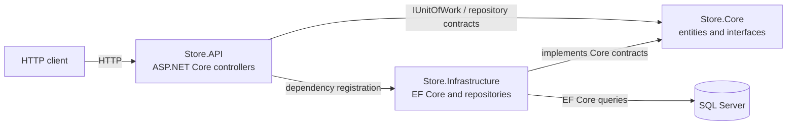
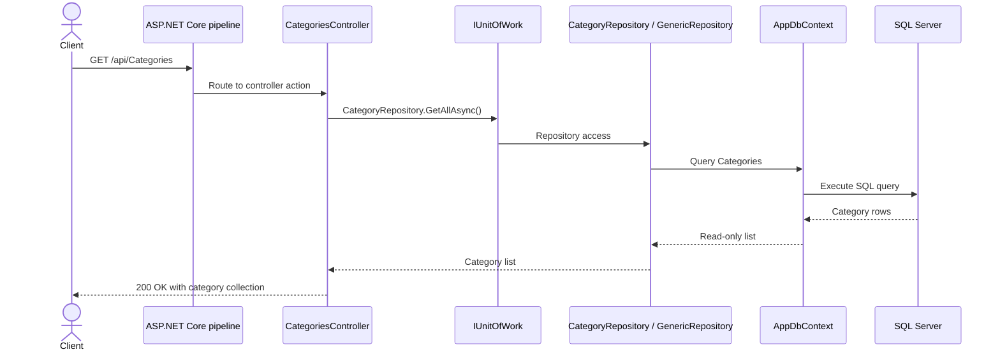
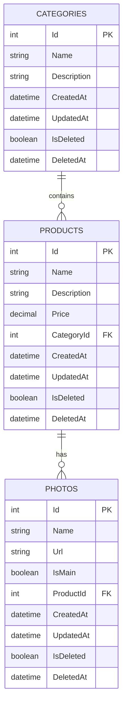

# Store Backend

Store Backend is an early-stage ASP.NET Core Web API for a store catalog. Its current codebase defines product, category, and photo entities, a SQL Server persistence layer using Entity Framework Core, and category CRUD endpoints. The repository is a foundation to build on, not a complete commerce backend: product and photo APIs, user accounts, authentication, checkout, and other store workflows are not implemented.

This README describes the implementation currently present in the repository. Sections labeled **Not implemented** or **Proposed** are not features of the application.

## Table of contents

- [Project status and capabilities](#project-status-and-capabilities)
- [Technology stack](#technology-stack)
- [Architecture](#architecture)
- [Project structure](#project-structure)
- [Prerequisites](#prerequisites)
- [Configuration](#configuration)
- [Setup](#setup)
- [Developer commands](#developer-commands)
- [Running and debugging](#running-and-debugging)
- [API](#api)
- [Database](#database)
- [Authentication and security](#authentication-and-security)
- [Errors and logging](#errors-and-logging)
- [Troubleshooting](#troubleshooting)
- [Development guidelines](#development-guidelines)
- [Deployment](#deployment)
- [Roadmap and known limitations](#roadmap-and-known-limitations)
- [Contributing](#contributing)
- [License](#license)

## Project status and capabilities

### Implemented

- ASP.NET Core Web API project targeting .NET 10.
- Entity Framework Core 10 with SQL Server provider and a configured `AppDbContext`.
- Catalog data model for categories, products, and product photos.
- Generic asynchronous repository operations, specialized repository interfaces, and a unit-of-work wrapper.
- Development-only OpenAPI and Swagger UI endpoints.
- Category endpoints to list, retrieve, create, update, and delete categories.
- An initial EF Core migration and seed data are present in the current working tree; see [Database](#database) for an important source-control limitation.

### Partially implemented

- Category CRUD routes return a shared `ApiResponse<T>` envelope with readable messages. Missing category IDs return `404 Not Found`; unexpected errors are handled by middleware.
- Product and photo entities and repositories exist, but no HTTP endpoints expose them.
- Base entities have `IsDeleted` and timestamp properties, but deletion is currently a physical delete and timestamps are not automatically maintained.
- A local `.env.example` is provided, but no separate environment profiles, deployment templates, or secrets-management integration are configured.

### Not implemented

There is no user or order model, registration/login flow, authentication, authorization policy, JWT handling, cart/checkout behavior, payment integration, image storage integration, pagination/filtering API contract, or health-check endpoint. Authentication and authorization are not configured, though the response middleware formats their status responses if added later.

## Technology stack

| Area | Technology | Role |
|---|---|---|
| Language | C# | API, domain entities, persistence, and repository implementation. |
| Runtime/framework | .NET 10 / ASP.NET Core 10 | HTTP hosting, controller routing, dependency injection, configuration, and logging. |
| API description | `Microsoft.AspNetCore.OpenApi` 10.0.14 and Swashbuckle.AspNetCore 10.3.1 | Produces the OpenAPI document and serves the Swagger UI in Development. |
| Data access | Entity Framework Core 10.0.14 | ORM, `DbContext`, entity mapping, and migrations. |
| Database | Microsoft SQL Server | Relational storage through `Microsoft.EntityFrameworkCore.SqlServer`. |
| Environment configuration | `DotNetEnv` 3.2.0 | Loads environment values from a `.env` file during startup. |
| Architecture | Three projects: API, Core, Infrastructure | Keeps HTTP concerns, entity/repository contracts, and persistence implementations separate. |
| CI / deployment | None configured | No CI workflow, container definition, or deployment template is present. |

The API project references Infrastructure; Infrastructure references Core. Core does not reference the other application projects.

## Architecture

### Overview

The application is a single ASP.NET Core process with a layered project structure, not a microservice system. The API registers controllers and Infrastructure services. Infrastructure configures `AppDbContext` with SQL Server and registers the generic repository and `IUnitOfWork`. Controllers use the unit of work to access repositories, which query the context.



### Component responsibilities

| Component | Responsibility |
|---|---|
| `Store.API` | Application entry point, configuration loading, controller registration, standardized response and error handling, HTTP pipeline, OpenAPI/Swagger UI mapping, and category routes. |
| `Store.Core` | Catalog entities and repository/unit-of-work interfaces. It contains no implemented business-service layer. |
| `Store.Infrastructure` | SQL Server `DbContext`, EF entity configurations, repository implementations, and dependency-injection registration. |
| `AppDbContext` | Exposes `Categories`, `Products`, and `Photos`; discovers entity configurations in the Infrastructure assembly. |
| `GenericRepository<T>` | Implements async list, get-by-ID, add, update, and delete operations using EF Core. Add, update, and delete each call `SaveChangesAsync` directly. |
| `UnitOfWork` | Creates category, product, and photo repository instances over a request-scoped context. No explicit transaction or `SaveChanges` method is exposed. |

### Request and data flow



The repository's no-argument `GetAllAsync` uses `AsNoTracking`. The overload accepting include expressions adds EF `Include` clauses. The get-by-ID methods throw `ArgumentException` when an entity is absent. `DeleteAsync` uses EF `Remove`, so it physically deletes the row.

There are no inter-service calls or third-party service integrations in the current implementation.

### Authentication flow

No authentication flow exists. The HTTP pipeline calls `UseAuthorization`, but the application does not register authentication handlers, users, roles, or authorization policies.

### Database relationships



The foreign keys use cascade delete in the available initial migration. The `Products.CategoryId` and `Photos.ProductId` foreign keys are indexed by that migration.

## Project structure

```text
Store-backend/
├── Store.API/
│   ├── Controllers/
│   │   ├── BaseController.cs
│   │   └── CategoriesController.cs
│   ├── Errors/
│   ├── Helper/
│   │   └── ApiResponse.cs
│   ├── MiddleWare/
│   │   └── ExceptionHandlingMiddleware.cs
│   ├── Properties/
│   │   └── launchSettings.json
│   ├── Mapping/
│   ├── Program.cs
│   ├── Store.API.csproj
│   ├── Store.API.http
│   ├── appsettings.json
│   └── appsettings.Development.json
├── Store.Core/
│   ├── Entities/
│   │   ├── BaseEntity.cs
│   │   └── Product/
│   │       ├── Category.cs
│   │       ├── Photo.cs
│   │       └── Product.cs
│   ├── Interfaces/
│   │   ├── ICategoryRepository.cs
│   │   ├── IGenericRepository.cs
│   │   ├── IPhotoRepository.cs
│   │   ├── IProductRepository.cs
│   │   └── IUnitOfWork.cs
│   └── Store.Core.csproj
├── Store.Infrastructure/
│   ├── Data/
│   │   ├── Config/
│   │   │   ├── CategoryConfigration.cs
│   │   │   └── ProductConfigration.cs
│   │   └── AppDbContext.cs
│   ├── Repositories/
│   │   ├── CategoryRepository.cs
│   │   ├── GenericRepository.cs
│   │   ├── PhotoRepossitory.cs
│   │   ├── ProductRepository.cs
│   │   └── UnitOfWork.cs
│   ├── InfrastructureRegistration.cs
│   └── Store.Infrastructure.csproj
├── .env.example
├── .gitignore
├── Store.slnx
└── README.md
```

`Store.slnx` places the projects in a solution folder named `src`; the project directories themselves are at the repository root. The empty root `src` entry is not where the projects currently live.

The current working tree also contains `Store.Infrastructure/Data/Migrations/` with an initial migration and model snapshot. **The repository's `.gitignore` ignores every `Migrations/` directory, and those files are not tracked.** They therefore will not be available in a clean clone unless migration source is made trackable and committed.

## Prerequisites

- .NET 10 SDK. Install from [Microsoft .NET downloads](https://dotnet.microsoft.com/download/dotnet/10.0).
- A SQL Server instance reachable from the API. SQL Server can be installed locally or provided by a development environment; see [SQL Server downloads](https://www.microsoft.com/sql-server/sql-server-downloads).
- A SQL login or Windows-integrated authentication identity with permission to create/use the configured database and apply schema changes.
- `dotnet-ef` CLI for adding or applying EF Core migrations. Install instructions are in [EF Core tools](https://learn.microsoft.com/ef/core/cli/dotnet).
- Git and a terminal (PowerShell on Windows; Bash or a compatible shell on Linux/macOS).

No Node.js, frontend runtime, message broker, cache, or external API is required by the current source.

## Configuration

### Connection string

The only application-specific configuration value currently required is `ConnectionStrings__StoreDb`. ASP.NET Core maps the double underscore to the `ConnectionStrings:StoreDb` key. Startup fails with an `InvalidOperationException` if the resulting connection string is blank.

The API loads `.env` using `DotNetEnv` with `NoClobber` and path traversal enabled. Existing process environment variables are not overwritten. ASP.NET Core's normal environment-variable configuration provider supports the same key and takes precedence over JSON configuration.

| Variable | Required | Purpose | Safe example |
|---|---:|---|---|
| `ConnectionStrings__StoreDb` | Yes | SQL Server connection string used by `AppDbContext`. | `Server=localhost;Database=Store;Trusted_Connection=True;TrustServerCertificate=True` |

`Logging:LogLevel` and `AllowedHosts` are settings in `Store.API/appsettings.json`, not additional required environment variables. The checked-in `.env.example` illustrates Windows integrated authentication. For SQL authentication, use a local-only value such as `Server=localhost;Database=Store;User Id=<user>;Password=<password>;TrustServerCertificate=True`; replace placeholders locally and never commit real credentials. For production, prefer managed identity or a secret store and validate the SQL Server certificate rather than enabling `TrustServerCertificate`.

### Local environment file

Copy the safe template and update the connection string for your machine:

**Windows PowerShell**

```powershell
Copy-Item .env.example .env
notepad .env
```

**Linux/macOS**

```bash
cp .env.example .env
${EDITOR:-vi} .env
```

The repository `.gitignore` excludes `.env` and other environment-specific files while allowing `.env.example`. Do not put credentials in source control, logs, screenshots, or issue reports.

To supply configuration without a file, set `ConnectionStrings__StoreDb` in the process/deployment environment. In PowerShell, for the current terminal session:

```powershell
$env:ConnectionStrings__StoreDb = "Server=localhost;Database=Store;Trusted_Connection=True;TrustServerCertificate=True"
```

In Bash:

```bash
export ConnectionStrings__StoreDb='Server=localhost;Database=Store;User Id=<user>;Password=<password>;TrustServerCertificate=True'
```

## Setup

1. **Clone the repository and enter its root.**

   ```powershell
   git clone <repository-url>
   Set-Location Store-backend
   ```

   ```bash
   git clone <repository-url>
   cd Store-backend
   ```

2. **Check the installed SDK.**

   ```text
   dotnet --info
   ```

   Confirm that a .NET 10 SDK is installed.

3. **Restore and build the solution.**

   ```text
   dotnet restore Store.slnx
   dotnet build Store.slnx
   ```

   Restore downloads project packages; build compiles the three projects. A successful build does not verify connectivity to SQL Server.

4. **Configure SQL Server.**

   Create or identify a SQL Server instance and ensure it accepts the authentication mode used by your connection string. Then create `.env` from `.env.example` as described above, and provide a valid database connection. The database name in the example is `Store`.

5. **Ensure an EF migration is available and apply it.**

   The initial migration is present only in the current working tree and is ignored by `.gitignore`; a normal clone will not contain it. Before using `database update`, make migration files available in the checkout. If there are no migrations, install the EF CLI and create one:

   ```text
   dotnet tool install --global dotnet-ef --version 10.0.14
   dotnet ef migrations add InitialCreate --project Store.Infrastructure --startup-project Store.API --output-dir Data/Migrations
   dotnet ef database update --project Store.Infrastructure --startup-project Store.API
   ```

   The global tool install is needed only if `dotnet ef` is not already available. Migration source must be added to source control for other developers to use it; the current ignore rule prevents that unless it is changed. The migration seeds two sample categories and two sample products. No photo seed rows exist.

6. **Run the API.**

   ```text
   dotnet run --project Store.API
   ```

   See [Running and debugging](#running-and-debugging) for local URLs and the current endpoint behavior.

## Developer commands

There are no `manage.ps1` or `manage.sh` scripts in this repository. Use the .NET CLI commands below.

| Command | Purpose |
|---|---|
| `dotnet restore Store.slnx` | Restore NuGet dependencies for all solution projects. |
| `dotnet build Store.slnx` | Compile the solution. |
| `dotnet run --project Store.API` | Run the API using the default launch profile. |
| `dotnet ef migrations add <Name> --project Store.Infrastructure --startup-project Store.API --output-dir Data/Migrations` | Create an EF Core migration. Ensure the output directory is not accidentally left ignored. |
| `dotnet ef database update --project Store.Infrastructure --startup-project Store.API` | Apply available migrations using the API startup configuration and configured connection string. |
| `dotnet publish Store.API/Store.API.csproj --configuration Release --output ./publish` | Produce a Release publish output for deployment. |

Commands use the same syntax in PowerShell, Bash, and macOS/Linux terminals. Windows path separators shown above are accepted by the .NET CLI; use `/` in paths when running in a Unix-like shell if preferred.

## Running and debugging

The `http` launch profile in `Store.API/Properties/launchSettings.json` sets `ASPNETCORE_ENVIRONMENT=Development`:

| Profile | URL |
|---|---|
| `http` (default) | `http://localhost:5189` |

Start the default profile from the repository root:

```text
dotnet run --project Store.API
```

To explicitly select the HTTP profile:

```text
dotnet run --project Store.API --launch-profile http
```

The application calls `UseHttpsRedirection`, but the checked-in launch settings define only an HTTP URL and no HTTPS launch profile. Configure an HTTPS endpoint or a correctly configured HTTPS-terminating host before relying on redirection. A SQL Server instance must be available for database-backed requests.

In Development, the OpenAPI JSON document is mapped at `/openapi/v1.json` and Swagger UI is served at `/swagger` (for example, `http://localhost:5189/swagger`). The UI reads the document from `/openapi/v1.json`. The `http` launch profile opens `swagger/index.html` in a browser automatically when you run the API from Visual Studio or with `dotnet run --project Store.API`. If it does not open automatically, navigate to `http://localhost:5189/swagger`. Both the UI and document are registered only in Development; they are not exposed by this setup in other environments. The application does not print a custom startup banner, expose a health endpoint, or configure a special shutdown procedure; stop the local process with Ctrl+C.

`Store.API/Store.API.http` currently contains a request to `/weatherforecast/`, but there is no corresponding controller or minimal API route. It is a stale sample; use the category request examples below instead.

## API

### Endpoint inventory

| Method | Path | Purpose | Request body | Success response |
|---|---|---|---|---|
| `GET` | `/api/Categories` | Return all categories. | None | `200 OK` with the collection in `data`. |
| `GET` | `/api/Categories/id/{id}` | Return one category by ID. | None | `200 OK` with the category in `data`. |
| `POST` | `/api/Categories` | Create a category. | `{"name":"Books","description":"Books and publications"}` | `201 Created` with the created category and a `Location` header. |
| `PUT` | `/api/Categories/update` | Update a category. | `{"id":1,"name":"Books","description":"Books and publications"}` | `200 OK` with the updated category in `data`. |
| `DELETE` | `/api/Categories/delete/{id}` | Delete a category. | None | `204 No Content`. |

No authentication token is required or configured. The controller accepts `CategoryDTO` for create and `UpdateCategoryDTO` for update. There is no API versioning, pagination, sorting, filtering, or custom request-header contract.

Example requests (replace the base URL or ID as needed):

```http
GET http://localhost:5189/api/Categories
Accept: application/json

###
GET http://localhost:5189/api/Categories/id/1
Accept: application/json

###
POST http://localhost:5189/api/Categories
Content-Type: application/json

{
  "name": "Books",
  "description": "Books and publications"
}

###
PUT http://localhost:5189/api/Categories/update
Content-Type: application/json

{
  "id": 1,
  "name": "Books",
  "description": "Books and publications"
}

###
DELETE http://localhost:5189/api/Categories/delete/1
```

All JSON success and error responses use the shared `ApiResponse<T>` format. Its fields are `success`, `message`, `data`, `errors`, and `meta`; unused fields are `null`. For example, an empty collection is still a successful response:

```json
{
  "success": true,
  "message": "No categories were found.",
  "data": [],
  "errors": null,
  "meta": null
}
```

Validation errors and known application errors use the same shape. Error items contain a `field` (null for non-field errors) and a readable `message`. Error `meta.traceId` lets operators correlate a response with server logs:

```json
{
  "success": false,
  "message": "Request validation failed.",
  "data": null,
  "errors": [
    {
      "field": "Name",
      "message": "The Name field is required."
    }
  ],
  "meta": {
    "pagination": null,
    "traceId": "00-..."
  }
}
```

Known category IDs that do not exist return `404 Not Found` with this envelope and a readable message. Unexpected errors are logged with their trace ID and return a generic `500` message; internal exception details are never included in the response. Authentication and authorization are not configured in this application; status-only `401`/`403` responses are formatted consistently if introduced by middleware later.

Paginated endpoints can attach `meta.pagination` using `PaginationMetadata.Create(page, pageSize, totalItems)`. It reports page, page size, total item/page counts, and previous/next availability. The current category list is not paginated, so it does not include pagination metadata.

The exception middleware maps known exceptions as follows; validation/model-binding failures are `400`, business-rule failures are `422`, and unexpected errors are `500`:

| Exception or condition | HTTP status |
|---|---:|
| `ValidationException`, `BadRequestException`, invalid model state | 400 |
| `NotFoundException` | 404 |
| `UnauthorizedException` / status-only authentication challenge | 401 |
| `ForbiddenException` / status-only authorization failure | 403 |
| `ConflictException` | 409 |
| `BusinessRuleException` | 422 |
| `RateLimitException` | 429 |
| `ServiceUnavailableException` | 503 |
| Unexpected exception | 500 |

Controller response metadata documents the success and expected error envelopes in the generated OpenAPI document. When adding an endpoint, return an `ApiResponse<T>` for JSON results, use the appropriate HTTP status, document its response types, and raise a known exception for errors instead of formatting error bodies locally.

## Database

### Engine and connection

SQL Server is the only configured provider. `InfrastructureRegistration.InfrastructureConfig` registers `AppDbContext` with `UseSqlServer` using `ConnectionStrings:StoreDb`. Configure it using `ConnectionStrings__StoreDb` in `.env` or the process environment.

### Schema

| Table | Properties and constraints |
|---|---|
| `Categories` | Identity `int` primary key; required `Name` (`nvarchar(100)`); required `Description`; base properties `CreatedAt`, `UpdatedAt`, `IsDeleted`, `DeletedAt`. |
| `Products` | Identity `int` primary key; required `Name` (`nvarchar(30)`), `Description` (`nvarchar(500)`), and `Price` (`decimal(18,2)`); required `CategoryId` foreign key to `Categories`. |
| `Photos` | Identity `int` primary key; required `Name`, `Url`, and `IsMain`; required `ProductId` foreign key to `Products`. The available initial migration maps `Name` and `Url` as `nvarchar(max)`. |

The category-to-product and product-to-photo relationships are one-to-many. The migration creates indexes on `Products.CategoryId` and `Photos.ProductId`, and configures cascade delete. The Core entities define navigation collections on `Category.Products` and `Product.Photos`, and reference navigations on `Product.Category` and `Photo.Product`.

`CategoryConfigration` seeds categories with IDs 1 and 2. `ProductConfigration` seeds products with IDs 1 and 2 and category IDs 1 and 2. These values are EF `HasData` seeds and are applied when the corresponding migration runs. There is no separate runtime seeding routine.

### Migration caveat and workflow

The current working tree contains `20261108124723_init` and `AppDbContextModelSnapshot`, but `.gitignore` contains a `Migrations/` rule and Git does not track those files. A clean clone therefore has no initial migration. For a dependable shared development or production workflow, migrations need to be made trackable and committed. Until then, `dotnet ef database update` in a clean clone will not have the repository's initial migration to apply.

After migrations are made available, the usual commands are:

```text
dotnet ef migrations add <Name> --project Store.Infrastructure --startup-project Store.API --output-dir Data/Migrations
dotnet ef database update --project Store.Infrastructure --startup-project Store.API
```

Review generated migration code before applying it, especially against any database containing existing data. The application does not automatically call `Migrate()` at startup. No backup/restore scripts are provided; use SQL Server's normal backup and restore procedures for the chosen hosting environment.

## Authentication and security

No application-level authentication or authorization is implemented. There is no account store, password hashing, JWT issuance/validation, refresh token flow, OAuth provider, role/permission model, CORS policy, rate limiting, or security-specific middleware. `UseAuthorization()` is in the request pipeline, but no authorization policies or authentication scheme are registered.

The API does enable HTTPS redirection and relies on ASP.NET Core's built-in configuration and logging. Keep credentials outside source control, use least-privilege database access, and use secure transport and certificate validation in deployment. These operational recommendations do not indicate that a production security configuration is already present.

## Errors and logging

- Logging uses ASP.NET Core's standard logging configuration in `appsettings.json`: `Information` for the default category and `Warning` for `Microsoft.AspNetCore`.
- `ExceptionHandlingMiddleware` maps known exceptions to HTTP status codes, logs unexpected errors, and returns the shared `ApiResponse<T>` envelope with a trace ID. Internal exception details are never returned to clients.
- Invalid model state and empty status-code responses use the same envelope. Errors use the application's response envelope rather than RFC 7807 Problem Details. There is no health check or monitoring integration.
- The generic repository throws `ArgumentException` when a requested ID is not found; the category controller translates those cases into `404 Not Found`.

For local diagnostics, check the application console output and confirm the SQL Server connection string points to a running instance. Avoid logging connection strings, credentials, or raw secrets.

## Troubleshooting

| Symptom | Possible cause | Diagnosis and resolution |
|---|---|---|
| Startup throws that `ConnectionStrings:StoreDb` is missing | `.env` is absent/invalid, variable name is wrong, or process configuration is missing. | From the repository root, confirm `.env` contains `ConnectionStrings__StoreDb=...`; verify the variable spelling and restart the process. Do not paste credentials into logs. |
| SQL connection refused or times out | SQL Server is stopped, host/port is incorrect, network access is blocked, or SQL Server is not configured to accept the selected connection type. | Check SQL Server availability independently, verify server and instance details in the connection string, then retry. |
| Login/database access error | Credentials or integrated-auth identity lack access to the server/database. | Confirm the selected authentication method, database name, and required database permissions with the SQL Server administrator. |
| `dotnet ef` is not recognized | EF Core CLI tool is not installed or not on `PATH`. | Install `dotnet-ef` version 10.0.14 as shown in [Setup](#setup), reopen the terminal if needed, and run `dotnet ef --version`. |
| `database update` says no migrations are available | Migration files are absent, as in a clean clone where `Migrations/` is ignored. | Make the intended migration source available and trackable, or generate a migration with the command in [Database](#database), review it, and apply it. |
| Port is already in use | Another process is bound to port 5189 (or to a port configured for a custom HTTPS endpoint). | Stop the conflicting development process or change the launch profile's `applicationUrl`, then use the updated URL. |
| HTTPS redirection does not work as expected | The checked-in launch profile configures only HTTP, without an HTTPS endpoint for local redirection. | Use the HTTP profile for local development or configure an HTTPS endpoint and follow Microsoft's [development certificate guidance](https://learn.microsoft.com/aspnet/core/security/enforcing-ssl) as appropriate. |
| `/weatherforecast/` returns 404 | `Store.API.http` contains an outdated template request; no such endpoint exists. | Use one of the category routes listed in [API](#api) instead. |
| A category request returns 404 | The requested category ID does not exist. | Check the ID; the response includes a readable message in the API response envelope. |
| A category request returns 500 | An unexpected error occurred, often from the database or another server-side operation. | Check application logs and SQL Server connectivity. The response includes a trace ID but never exposes internal exception details. |
| PowerShell refuses to run a `.ps1` file | This repository does not include management scripts; if using a local script, execution policy may restrict it. | Do not expect `manage.ps1` to exist. For any separately supplied trusted script, follow your organization's PowerShell policy rather than weakening it globally. |
| Bash reports permission denied for a script | No management shell script is included. | Use the `dotnet` commands in [Developer commands](#developer-commands). |
| Build fails after restore | SDK mismatch, package restore issue, or a compile error in current source. | Run `dotnet --info`, `dotnet restore Store.slnx`, then `dotnet build Store.slnx` and inspect the first compiler/restore error. |

## Development guidelines

There is no formal contribution/style guide enforced by a formatter or analyzer configuration. The following practices are recommendations consistent with the current project layout:

- Keep HTTP concerns in `Store.API`, shared domain entities and abstractions in `Store.Core`, and database/provider-specific code in `Store.Infrastructure`.
- Prefer constructor injection and register new persistence services through `InfrastructureRegistration`.
- Keep API input/output contracts explicit with request and response DTOs rather than exposing EF entities directly.
- Return stable HTTP status codes and a consistent error format; do not return exception objects to clients.
- Add and review an EF migration when changing the persisted model. Do not rely on local-only migration files.
- Use clear C# type/member names and `PascalCase` for public types and members. Existing spelling/style inconsistencies (for example, `Configration` and `PhotoRepossitory`) are present; avoid expanding them, and rename only with appropriate reference updates.
- Do not assume the current `IUnitOfWork` provides transaction coordination: the generic repository saves changes for each add/update/delete operation.
- Keep secrets in local environment/deployment configuration and out of tracked files.

No branch naming, commit-message, or pull-request policy is currently defined. As a suggested workflow, use a short descriptive feature/fix branch, make focused commits, and explain behavior changes and configuration/database impact in the pull request.

## Deployment

No Dockerfile, Compose configuration, CI/CD workflow, cloud-hosting configuration, deployment script, health endpoint, or production secrets integration is included. The following is a general deployment outline, not a preconfigured or verified deployment target:

1. Build/publish the API:

   ```text
   dotnet publish Store.API/Store.API.csproj --configuration Release --output ./publish
   ```

2. Configure `ConnectionStrings__StoreDb` through the host's protected configuration mechanism. Do not deploy a development `.env` file.
3. Provision SQL Server and apply a reviewed, committed migration using an authorized deployment identity.
4. Run the published application behind an HTTPS-terminating reverse proxy or on a host configured for HTTPS. Ensure proxy forwarding behavior is configured correctly if required by the hosting platform.
5. Configure log collection and operational monitoring at the hosting layer; the application does not provide a health endpoint or monitoring integration.
6. Plan rollback of both the application and schema. No automated rollback or backup process is supplied; coordinate database backup and migration strategy before production use.

Do not expose the Development OpenAPI document or development database credentials as a production interface/configuration.

## Roadmap and known limitations

No confirmed project roadmap is present. The following are observations and possible next steps, not announced commitments:

### Current limitations

- Category CRUD routes return `ApiResponse<T>` envelopes, but entities are still exposed directly and errors do not use RFC 7807 Problem Details.
- Product/photo persistence abstractions exist but are not exposed through API endpoints.
- No authentication, authorization, pagination API, health checks, or deployment automation.
- The initial migration is excluded from Git by the current ignore rule.
- Base timestamps and soft-delete fields are not automatically applied; repository deletion is physical.

### Proposed improvements

- Make migration sources trackable, commit them, and document a repeatable database setup.
- Add product/photo APIs with request validation, response DTOs, and consistent error handling; improve the category API's error and response contracts.
- Decide and implement authentication/authorization requirements before exposing protected store operations.
- Define soft-delete/timestamp behavior, database transaction boundaries, and operational health/logging requirements.
- Add deployment automation only after selecting and documenting the intended hosting environment.

## Contributing

Contributions can be proposed through the repository's normal Git hosting workflow. No formal `CONTRIBUTING.md` or project-specific pull-request template is present.

1. Fork or branch from the repository's normal development branch.
2. Create a focused branch, for example `feature/category-api` or `fix/config-validation`.
3. Implement a focused change using the project boundaries described above.
4. Run `dotnet restore Store.slnx` and `dotnet build Store.slnx`.
5. Include a concise description, rationale, and configuration/database impact in the pull request. Never include secrets.

## License

No `LICENSE` file is present in the repository. No license has been specified.
