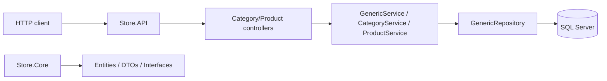

# Store Backend

Store Backend is a .NET 10 ASP.NET Core Web API for a simple catalog-style backend. The repository currently includes a reusable CRUD API layer, EF Core persistence with SQL Server, and concrete category and product endpoints built on top of that foundation.

This README reflects the current state of the codebase and is intended to help developers understand the project structure, configuration, and available API surface.

## Table of contents

- [Project status](#project-status)
- [Technology stack](#technology-stack)
- [Architecture](#architecture)
- [Project structure](#project-structure)
- [Prerequisites](#prerequisites)
- [Configuration](#configuration)
- [Setup](#setup)
- [Running the API](#running-the-api)
- [API endpoints](#api-endpoints)
- [Database model](#database-model)
- [Authentication and security](#authentication-and-security)
- [Known limitations](#known-limitations)

## Project status

### Implemented

- ASP.NET Core Web API targeting .NET 10
- Entity Framework Core 10 with the SQL Server provider
- Catalog domain model for categories, products, and product photos
- Generic repository and service abstractions for CRUD operations
- Concrete `CategoryController` and `ProductController` endpoints
- AutoMapper configuration via `MappingProfile`
- Shared API response envelope and exception handling middleware
- OpenAPI/Swagger generation for development
- Environment variable loading with `DotNetEnv`

### Partially implemented

- The project has a working CRUD foundation for catalog resources, but it is still focused on backend infrastructure rather than a full storefront workflow.
- `BaseEntity<int>` provides shared ID behavior and is used consistently by the domain model.
- The repository contains startup and infrastructure wiring for the catalog domain, but there are no authentication or user-management features yet.

### Not implemented

The following are not part of the current codebase:

- User accounts, JWT, roles, or authorization policies
- Orders, carts, checkout, payments, or shipping
- Product image upload, inventory tracking, or stock management
- Advanced validation, audit trails, or soft-delete workflows beyond the base model shape
- Health checks, distributed tracing, and deployment automation

## Technology stack

| Area | Technology | Purpose |
|---|---|---|
| Language | C# | Application code |
| Runtime | .NET 10 / ASP.NET Core 10 | Web API host and HTTP pipeline |
| Data access | EF Core 10 | ORM and persistence layer |
| Database | SQL Server | Relational storage |
| Mapping | AutoMapper | DTO/entity mapping |
| Environment config | DotNetEnv | Loads `.env` values at startup |
| API docs | OpenAPI + Swagger UI | Local API documentation |
| Layering | Core / Infrastructure / API | Separate domain, persistence, and API concerns |

## Architecture

The solution follows a three-layer structure:

- `Store.Core`: entities, DTOs, interfaces, and shared domain abstractions
- `Store.Infrastructure`: `AppDbContext`, repositories, and infrastructure registration
- `Store.API`: controllers, services, middleware, and startup configuration



### Current responsibility boundaries

| Component | Responsibility |
|---|---|
| `Store.API` | HTTP endpoints, middleware, DTO handling, and startup configuration |
| `Store.Infrastructure` | EF Core context, repository implementations, and DI registration |
| `Store.Core` | Domain entities, DTO records, interfaces, and exceptions |
| `BaseController<TResponse, TCreateRequest, TUpdateRequest>` | Shared CRUD route behavior for integer-keyed resources |
| `GenericService<TEntity, ...>` | Common create/read/update/delete logic |
| `AppDbContext` | Exposes `Categories`, `Products`, and `Photos` as EF Core sets |
| `MappingProfile` | Maps entity and request models to DTOs and back |

## Project structure

```text
Store-backend/
├── .env.example
├── .gitignore
├── README.md
├── Store.slnx
├── Store.API/
│   ├── Controllers/
│   │   ├── BaseController.cs
│   │   ├── CategoryController.cs
│   │   └── ProductController.cs
│   ├── DTO/
│   │   └── PaginationQuery.cs
│   ├── Errors/
│   │   └── ApiExceptions.cs
│   ├── Helper/
│   │   └── ApiResponse.cs
│   ├── Mapping/
│   │   └── MappingProfile.cs
│   ├── MiddleWare/
│   │   └── ExceptionHandlingMiddleware.cs
│   ├── Services/
│   │   ├── CategoryService.cs
│   │   ├── GenericService.cs
│   │   └── ProductService.cs
│   ├── Properties/
│   │   └── launchSettings.json
│   ├── Program.cs
│   ├── Store.API.csproj
│   ├── Store.API.http
│   ├── appsettings.json
│   └── appsettings.Development.json
├── Store.Core/
│   ├── DTO/
│   │   ├── CategoryDTO.cs
│   │   ├── ProductDTO.cs
│   │   └── PagedResult.cs
│   ├── Entities/
│   │   ├── BaseEntity.cs
│   │   └── Product/
│   │       ├── Category.cs
│   │       ├── Photo.cs
│   │       └── Product.cs
│   ├── Exceptions/
│   │   └── NotFoundException.cs
│   ├── Interfaces/
│   │   ├── Repositories/
│   │   └── Services/
│   └── Store.Core.csproj
├── Store.Infrastructure/
│   ├── Data/
│   │   └── AppDbContext.cs
│   ├── Repositories/
│   │   ├── CategoryRepository.cs
│   │   ├── GenericRepository.cs
│   │   ├── ProductRepository.cs
│   │   └── UnitOfWork.cs
│   ├── InfrastructureRegistration.cs
│   └── Store.Infrastructure.csproj
└── src/
    └── (empty placeholder directory)
```

> Note: `src/` is currently only a placeholder and the real application projects live in the repository root.

## Prerequisites

- .NET 10 SDK
- SQL Server instance or a reachable local SQL Server database
- User permissions to create and use the target database
- Git and a terminal
- Optional: `dotnet-ef` if you want to manage migrations from the command line

## Configuration

### Required connection string

The API expects a connection string named `StoreDb`:

```csharp
builder.Configuration.GetConnectionString("StoreDb")
```

This is populated from the environment and can be set in a local `.env` file using the ASP.NET Core environment variable convention:

```env
ConnectionStrings__StoreDb=Server=localhost;Database=Store;Trusted_Connection=True;TrustServerCertificate=True
```

The project calls `Env.NoClobber().TraversePath().Load();` at startup, which loads the repository-root `.env` file without overwriting any existing environment variables already set in the process.

### `.env.example`

The repository includes a safe template for local setup:

```env
ConnectionStrings__StoreDb=Server=localhost;Database=Store;Trusted_Connection=True;TrustServerCertificate=True
```

For SQL authentication, use a local-only value such as:

```env
ConnectionStrings__StoreDb=Server=localhost;Database=Store;User Id=myuser;Password=yourStrongPassword;TrustServerCertificate=True
```

Never commit a real password or secret.

## Setup

1. Clone the repository:

   ```bash
   git clone <repository-url>
   cd Store-backend
   ```

2. Create a local environment file:

   ```powershell
   Copy-Item .env.example .env
   ```

   or on Unix-like systems:

   ```bash
   cp .env.example .env
   ```

3. Update the database connection string in `.env`.

4. Restore and build the solution:

   ```bash
   dotnet restore Store.slnx
   dotnet build Store.slnx
   ```

5. Run the API:

   ```bash
   dotnet run --project Store.API
   ```

## Running the API

The launch profile in `Store.API/Properties/launchSettings.json` configures local development URLs. The application also enables HTTPS redirection and Swagger/OpenAPI in development mode.

Start the API with:

```bash
dotnet run --project Store.API
```

Then open:

- `http://localhost:5189/swagger`
- `http://localhost:5189/openapi/v1.json`

## API endpoints

The repository currently exposes concrete CRUD endpoints for categories and products through the generic base controller pattern.

### Category endpoints

Base route: `api/category`

- `GET /api/category?page=1&pageSize=10`
- `GET /api/category/{id:int}`
- `POST /api/category`
- `PUT /api/category/{id:int}`
- `DELETE /api/category/{id:int}`

### Product endpoints

Base route: `api/product`

- `GET /api/product?page=1&pageSize=10`
- `GET /api/product/{id:int}`
- `POST /api/product`
- `PUT /api/product/{id:int}`
- `DELETE /api/product/{id:int}`

### Request shapes

Category request models:

```csharp
public record CreateCategoryRequest(string Name, string Description);
public record UpdateCategoryRequest(int Id, string Name, string Description);
```

Product request models:

```csharp
public record CreateProductRequest(string Name, string Description, decimal Price);
public record UpdateProductRequest(int Id, string Name, string Description, decimal Price);
```

## Database model

The EF Core model includes:

- `Category`
- `Product`
- `Photo`

The domain objects currently model a simple product catalog with product-to-category relationships:

```csharp
public class Category : BaseEntity<int>
{
    public string Name { get; set; }
    public string Description { get; set; }
    public ICollection<Product> Products { get; set; } = new HashSet<Product>();
}

public class Product : BaseEntity<int>
{
    public string Name { get; set; }
    public string Description { get; set; }
    public decimal Price { get; set; }
    public int CategoryId { get; set; }
    public Category Category { get; set; }
    public ICollection<Photo> Photos { get; set; } = new HashSet<Photo>();
}
```

`AppDbContext` is configured to use SQL Server and register the catalog sets.

## Authentication and security

This repository does not currently implement authentication or authorization.

Current state:

- No user model or identity provider
- No JWT or bearer-token authentication
- No authorization policies or role enforcement
- No login or registration endpoints
- No API key or secret management beyond `.env` local configuration

Validation is handled through ASP.NET Core model validation and shared error responses, but there is no custom security model around user access yet.

## Known limitations

- The project is a backend foundation, not a complete commerce application
- There is no user management, cart, order, or checkout flow
- Product images are modeled but no photo upload or media endpoint is implemented yet
- There are no migration files checked into source control by default
- The code currently uses straightforward EF Core CRUD patterns without a richer business-layer abstraction or audit pipeline
- There is no health check endpoint, observability pipeline, or deployment configuration yet

## License

This project does not currently include a repository-level license file. Add one before publicly distributing or reusing the project in a production or commercial context.

