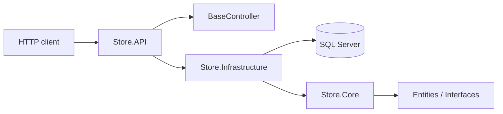

# Store Backend

Store Backend is an ASP.NET Core Web API foundation for a catalog-style backend. The repository currently contains the domain model, EF Core persistence setup, generic repository abstractions, and a reusable CRUD controller scaffold. It is still a backend skeleton rather than a complete commerce application.

This README reflects the code that exists in the repository today, not planned features.

## Table of contents

- [Project status](#project-status)
- [Technology stack](#technology-stack)
- [Architecture](#architecture)
- [Project structure](#project-structure)
- [Prerequisites](#prerequisites)
- [Configuration](#configuration)
- [Setup](#setup)
- [Developer commands](#developer-commands)
- [Running the API](#running-the-api)
- [API status](#api-status)
- [Database](#database)
- [Authentication and security](#authentication-and-security)
- [Known limitations](#known-limitations)

## Project status

### Implemented

- ASP.NET Core Web API targeting .NET 10.
- EF Core 10 with the SQL Server provider.
- Core entities for categories, products, and product photos.
- `AppDbContext` with `DbSet` members for the catalog entities.
- Generic repository contract and implementation for common CRUD operations.
- Unit-of-work registration and infrastructure dependency injection setup.
- Reusable `BaseController<TResponse, TCreateRequest, TUpdateRequest>` generic CRUD scaffold.
- Development-only OpenAPI generation and Swagger UI.
- `.env` loading support via `DotNetEnv`.

### Partially implemented

- The infrastructure layer is in place for SQL Server access and persistence.
- The base controller is implemented as a reusable template for API resources.
- `BaseEntity<int>` provides common ID and timestamp-style fields, but the application is not yet using a full soft-delete or audit pipeline consistently.
- The project includes a root `.env.example` template and `.gitignore` rules for environment files.

### Not implemented

The following are not present in the current codebase:

- Concrete resource controllers such as `CategoriesController`, `ProductsController`, or `PhotosController`.
- Concrete service classes such as `CategoryService` or product services.
- Request/response DTOs for category/product endpoints.
- Authentication, authorization, JWT, identity, sessions, or user accounts.
- Order, cart, checkout, payment, inventory, or shipping flows.
- Health checks, API versioning, or custom middleware beyond the exception and status-code handling.
- Concrete endpoint registration for the catalog resources beyond the generic base controller scaffold.

## Technology stack

| Area | Technology | Purpose |
|---|---|---|
| Language | C# | Application code and domain model |
| Runtime | .NET 10 / ASP.NET Core 10 | Web API and dependency injection |
| Data access | Entity Framework Core 10 | ORM and EF Core persistence |
| Database | SQL Server | Relational storage |
| Environment config | DotNetEnv 3.2.0 | Loads `.env` values during startup |
| API docs | Microsoft.AspNetCore.OpenApi + Swashbuckle | OpenAPI document and Swagger UI |
| Project separation | Core, Infrastructure, API | Keeps domain, persistence, and API concerns separate |

## Architecture

The application follows a three-layer structure:

- `Store.Core`: domain entities, DTO contracts, general interfaces, and shared application abstractions.
- `Store.Infrastructure`: EF Core `DbContext`, repository implementations, and dependency registration.
- `Store.API`: ASP.NET Core host, middleware, generic controller scaffold, and startup configuration.



### Current responsibility boundaries

| Component | Responsibility |
|---|---|
| `Store.API` | Startup, middleware, OpenAPI setup, and the generic controller scaffold |
| `Store.Infrastructure` | `AppDbContext`, `GenericRepository<T>`, infrastructure registration |
| `Store.Core` | Entities, contracts, exceptions, and shared domain types |
| `BaseController<TResponse, TCreateRequest, TUpdateRequest>` | Shared CRUD actions for API resources with integer IDs |
| `GenericRepository<T>` | Common EF Core CRUD operations |
| `UnitOfWork` | Exists as a repository wrapper and DI registration target |
| `AppDbContext` | Exposes `Categories`, `Products`, and `Photos` as EF Core sets |

## Project structure

```text
Store-backend/
├── .env.example
├── .gitignore
├── README.md
├── Store.slnx
├── Store.API/
│   ├── Controllers/
│   │   └── BaseController.cs
│   ├── DTO/
│   │   └── PaginationQuery.cs
│   ├── Helper/
│   │   └── ApiResponse.cs
│   ├── MiddleWare/
│   │   └── ExceptionHandlingMiddleware.cs
│   ├── Mapping/
│   │   └── CategoryMapping.cs
│   ├── Properties/
│   │   └── launchSettings.json
│   ├── Program.cs
│   ├── Store.API.csproj
│   └── appsettings*.json
├── Store.Core/
│   ├── DTO/
│   │   └── PagedResult.cs
│   ├── Entities/
│   │   ├── BaseEntity.cs
│   │   └── Product/
│   │       ├── Category.cs
│   │       ├── Photo.cs
│   │       └── Product.cs
│   ├── Exceptions/
│   │   └── NotFoundException.cs
│   ├── Interfaces/
│   │   ├── IGenericRepository.cs
│   │   ├── IGenericService.cs
│   │   ├── IUnitOfWork.cs
│   │   └── ...
│   └── Store.Core.csproj
├── Store.Infrastructure/
│   ├── Data/
│   │   ├── AppDbContext.cs
│   │   └── Config/
│   │       ├── CategoryConfigration.cs
│   │       └── ProductConfigration.cs
│   ├── Repositories/
│   │   ├── GenericRepository.cs
│   │   └── UnitOfWork.cs
│   ├── InfrastructureRegistration.cs
│   └── Store.Infrastructure.csproj
└── src/
    └── (empty solution folder placeholder)
```

Important note: the `src/` directory is empty and does not contain the project folders. The actual application projects are at the repository root.

## Prerequisites

- .NET 10 SDK
- A reachable SQL Server instance
- A user account with rights to create and use the target database
- Git and a terminal
- `dotnet-ef` if you plan to add or apply migrations

## Configuration

### Required application setting

The app expects a connection string key named `ConnectionStrings__StoreDb`.

Startup fails with an `InvalidOperationException` if the value is empty or missing.

Example in a `.env` file:

```env
ConnectionStrings__StoreDb=Server=localhost;Database=Store;Trusted_Connection=True;TrustServerCertificate=True
```

The project loads `.env` with `DotNetEnv` and ignores clobbering of existing process environment variables. ASP.NET Core configuration values from the environment and appsettings still work as normal.

### `.env.example`

The repository includes a safe template and ignores real local environment files via `.gitignore`.

Example:

```env
ConnectionStrings__StoreDb=Server=localhost;Database=Store;Trusted_Connection=True;TrustServerCertificate=True
```

For SQL authentication, use a local-only value such as:

```env
ConnectionStrings__StoreDb=Server=localhost;Database=Store;User Id=myuser;Password=MyPassword;TrustServerCertificate=True
```

Never commit a real password or secret.

## Setup

1. Clone the repository.

   ```bash
   git clone <repository-url>
   cd Store-backend
   ```

2. Create the local environment file.

   ```powershell
   Copy-Item .env.example .env
   ```

   or on Unix-like systems:

   ```bash
   cp .env.example .env
   ```

3. Update the database connection string in `.env`.

4. Restore and build the solution.

   ```bash
   dotnet restore Store.slnx
   dotnet build Store.slnx
   ```

5. Run the API.

   ```bash
   dotnet run --project Store.API
   ```

## Developer commands

| Command | Purpose |
|---|---|
| `dotnet restore Store.slnx` | Restore project dependencies |
| `dotnet build Store.slnx` | Compile the solution |
| `dotnet run --project Store.API` | Start the API |
| `dotnet ef migrations add <Name> --project Store.Infrastructure --startup-project Store.API --output-dir Data/Migrations` | Create an EF migration |
| `dotnet ef database update --project Store.Infrastructure --startup-project Store.API` | Apply migrations |
| `dotnet publish Store.API/Store.API.csproj --configuration Release --output ./publish` | Create a deployment payload |

## Running the API

The launch profile in `Store.API/Properties/launchSettings.json` configures a local HTTP endpoint:

- `http://localhost:5189`

Start it with:

```bash
dotnet run --project Store.API
```

The project also enables Swagger UI in Development mode:

- `http://localhost:5189/swagger`
- OpenAPI JSON: `http://localhost:5189/openapi/v1.json`

The API also calls `UseHttpsRedirection()`, but the checked-in launch profile only configures HTTP. If HTTPS is required, add a proper HTTPS profile or a reverse proxy that terminates TLS.

## API status

At the moment, the repository does not contain concrete API endpoints that are fully wired and exposed to clients. The generic controller is available as a reusable scaffold, but no endpoint classes such as `CategoriesController` are present in the current working tree.

The `BaseController<TResponse, TCreateRequest, TUpdateRequest>` currently provides the common CRUD route shape for resources with integer `Id` values, including:

- `GET /api/[controller]`
- `GET /api/[controller]/{id:int}`
- `POST /api/[controller]`
- `PUT /api/[controller]/{id:int}`
- `DELETE /api/[controller]/{id:int}`

However, that scaffold must be inherited by a concrete controller before it becomes an active endpoint.

The project does not currently register any concrete service implementation or generic service binding for category/product resource types in `Program.cs`.

## Database

The `AppDbContext` configures the EF Core database model:

- `Categories`
- `Products`
- `Photos`

Entity configuration classes are discovered via:

```csharp
modelBuilder.ApplyConfigurationsFromAssembly(Assembly.GetExecutingAssembly());
```

The project includes SQL Server configuration through `UseSqlServer(configuration.GetConnectionString("StoreDb"))`.

The repository contains a migration directory in the working tree, but the `.gitignore` rule currently ignores `Migrations/` directories. This means migration files are not tracked by default and will not be present in a clean clone unless the ignore rule is changed or the migration files are committed intentionally.

## Authentication and security

No authentication or authorization setup is present.

Current code state:

- No identity provider or user tables
- No JWT or bearer-token configuration
- No authorization policies
- No role-based enforcement
- No login/register endpoints
- No secret-management integration beyond keeping `.env` out of source control

The project does not currently implement input validation beyond ASP.NET Core model validation behavior and the shared API error envelope.

## Known limitations

- The repository is a foundation, not a production-ready store API.
- No concrete business endpoints are implemented yet.
- No real category/product service layer is registered in the API startup configuration.
- No migration source is guaranteed to be present in a fresh clone because `Migrations/` is ignored.
- The project uses physical deletes and has no transaction boundaries for coordinated multi-step writes.
- There is no health-check endpoint, observability pipeline, or deployment configuration.
- There is no user, cart, or checkout domain layer.

## Notes for future development

When the project grows beyond the scaffold, the next natural steps are:

1. Add concrete API resource controllers.
2. Add service interfaces and implementations for category/product resources.
3. Add request and response DTOs for each resource.
4. Register concrete services in `Program.cs`.
5. Add real migration files to version control.
6. Introduce authentication and authorization when user workflows are required.
7. Expand persistence and business logic for catalog, orders, and customer flows.

## License

This project does not currently declare a license in the repository root. Check the repository settings or add a license file before distributing the project publicly.
