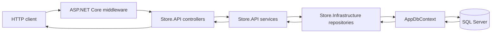

# Store Backend

Store Backend is a .NET 10 ASP.NET Core Web API for managing products, product images, and a hierarchical category catalog. It uses a layered design with API controllers, application services, repository contracts, and Entity Framework Core persistence to SQL Server.

## Table of contents

- [Features and scope](#features-and-scope)
- [Technology stack](#technology-stack)
- [Architecture](#architecture)
- [Project structure](#project-structure)
- [Prerequisites](#prerequisites)
- [Setup](#setup)
- [Environment variables](#environment-variables)
- [Run the application](#run-the-application)
- [Database migrations and development seed data](#database-migrations-and-development-seed-data)
- [API overview](#api-overview)
- [Troubleshooting](#troubleshooting)
- [Production notes](#production-notes)

## Features and scope

- Category and product CRUD endpoints.
- Nested categories with parent/child relationships.
- Product and category pagination.
- Local image-file saving during product creation and update.
- Entity Framework Core persistence with SQL Server.
- Auditing metadata and global soft-delete filters for entities derived from `BaseEntity<int>`.
- Consistent success and error response envelopes.
- Centralized exception-to-HTTP-status mapping.
- `.env` loading through DotNetEnv before ASP.NET Core host construction.
- Optional, idempotent development seed data, disabled by default.
- Development-only OpenAPI and Swagger UI.

Authentication, authorization, JWT, CORS policies, orders, carts, and payment processing are not implemented. Image files are written to the local file system; static-file serving and a standalone image-management API are not configured.

## Technology stack

| Area | Technology |
|---|---|
| Language and target framework | C#, .NET 10 (`net10.0`) |
| Web framework | ASP.NET Core 10.0.14, MVC controllers |
| Database | SQL Server |
| Data access and migrations | Entity Framework Core 10.0.14 |
| Object mapping | AutoMapper 16.3.0 |
| Environment files | DotNetEnv 3.2.0 |
| API description | ASP.NET Core OpenAPI 10.0.14 and Swashbuckle.AspNetCore 10.3.1 |
| Request validation | Data Annotations, `IValidatableObject`, and project validation helpers |

## Architecture

The solution is divided into three projects. This is a layered architecture; it is not a separate-domain-project Clean Architecture template.



- **API (`Store.API`)**: startup, HTTP controllers, application services, DTO mappings, options, response formatting, and exception middleware.
- **Core (`Store.Core`)**: entities, API DTOs, validation helpers, and service/repository contracts.
- **Infrastructure (`Store.Infrastructure`)**: `AppDbContext`, EF Core configurations and migrations, repositories, and the development data seeder.

A typical request passes through middleware, a controller, a service, a repository, and `AppDbContext`. EF Core applies the entity configurations and soft-delete query filters before communicating with SQL Server. The API maps results to DTOs and wraps JSON responses in the shared response format. The `DELETE` endpoints return `204 No Content`.

All collection and single-resource `GET` endpoints accept the optional `includeDeleted` query parameter. It defaults to `false`; pass `includeDeleted=true` to include soft-deleted records.

## Project structure

```text
Store-backend/
├── .env.example
├── README.md
├── Store.slnx
├── Store.API/
│   ├── Configuration/
│   │   ├── DatabaseOptions.cs
│   │   └── SeedDatabaseOptions.cs
│   ├── Controllers/
│   │   ├── BaseController.cs
│   │   ├── CategoryController.cs
│   │   └── ProductController.cs
│   ├── DTO/PaginationQuery.cs
│   ├── Exceptions/ApiExceptions.cs.cs
│   ├── Helper/ApiResponse.cs
│   ├── Mapping/
│   ├── MiddleWare/ExceptionHandlingMiddleware.cs
│   ├── Properties/launchSettings.json
│   ├── Services/
│   ├── wwwroot/Images/
│   ├── Program.cs
│   ├── appsettings.json
│   └── appsettings.Development.json
├── Store.Core/
│   ├── DTO/
│   │   ├── Category/
│   │   ├── Image/
│   │   └── Product/
│   ├── Entities/
│   ├── Interfaces/
│   │   ├── Entities/
│   │   ├── Repositories/
│   │   └── Services/
│   ├── Validation/ValidationRules.cs
│   └── Store.Core.csproj
└── Store.Infrastructure/
    ├── Data/
    │   ├── Config/
    │   ├── Migrations/
    │   ├── Seeding/DbSeeder.cs
    │   └── AppDbContext.cs
    ├── Repositories/
    └── Store.Infrastructure.csproj
```

Notable implementation files:

- [`Program.cs`](Store.API/Program.cs): loads `.env`, configures options and dependency injection, sets up middleware, and runs optional development seed data.
- [`BaseController.cs`](Store.API/Controllers/BaseController.cs): shared paginated CRUD routes.
- [`AppDbContext.cs`](Store.Infrastructure/Data/AppDbContext.cs): EF Core context, audit metadata, and global soft-delete filters.
- [`DbSeeder.cs`](Store.Infrastructure/Data/Seeding/DbSeeder.cs): migration-first, idempotent development sample data.
- [`ExceptionHandlingMiddleware.cs`](Store.API/MiddleWare/ExceptionHandlingMiddleware.cs): maps exceptions to consistent error responses.
- [`launchSettings.json`](Store.API/Properties/launchSettings.json): IDE launch profile; runtime environment and URL are configured outside the launch profile.

## Prerequisites

- .NET 10 SDK.
- A SQL Server instance accessible to the application.
- Git.
- EF Core CLI (`dotnet-ef`) for migration commands.
- PowerShell on Windows or a POSIX-compatible shell on macOS/Linux.

Verify the SDK and EF CLI:

```console
dotnet --version
dotnet ef --version
```

If EF CLI is not installed, install the matching major version:

```console
dotnet tool install --global dotnet-ef --version 10.0.14
```

## Setup

From the repository root:

1. Clone the repository and enter its directory.

   ```console
   git clone <repository-url>
   cd Store-backend
   ```

2. Create a local environment file from the safe example.

   PowerShell:

   ```powershell
   Copy-Item .env.example .env
   ```

   Bash:

   ```bash
   cp .env.example .env
   ```

3. Edit `.env` and set `ConnectionStrings__StoreDb` for your SQL Server. Do not commit `.env`; it is ignored by Git.

4. Restore and build the solution.

   ```console
   dotnet restore Store.slnx
   dotnet build Store.slnx --no-restore
   ```

5. Apply the existing migrations, then run the API:

   ```console
   dotnet ef migrations add init --project Store.Infrastructure --startup-project Store.API --output-dir Data/Migrations
   dotnet run --project Store.API
   ```

The included `.env.example` uses a local SQL Server connection with integrated authentication. Change it to match the authentication mode and endpoint supported by your SQL Server installation.

## Environment variables

`Program.cs` loads `.env` with `Env.NoClobber().TraversePath().Load()` before calling `WebApplication.CreateBuilder`. Existing process or hosting environment variables take precedence over values in `.env`. ASP.NET Core maps double underscores (`__`) in environment-variable names to configuration section separators.

The database connection and development seed switch are represented by typed `DatabaseOptions` and `SeedDatabaseOptions`. The database options use data-annotation validation, and both options are validated during host startup.

| Name | Description | Required | Default if unset | Example |
|---|---|---:|---|---|
| `ASPNETCORE_ENVIRONMENT` | ASP.NET Core environment; Swagger and seed-data gating depend on this value. | No | `Production` | `Development` |
| `ASPNETCORE_URLS` | URLs the web host binds to; set this to change the local port. | No | ASP.NET Core host default | `http://localhost:5189` |
| `ConnectionStrings__StoreDb` | SQL Server connection string used by `AppDbContext`. Startup fails if absent or blank. | Yes | None | `Server=localhost;Database=Store;Trusted_Connection=True;TrustServerCertificate=True` |
| `SEED_DATABASE` | Opt-in switch for development sample data. `true` is rejected outside Development. | No | `false` | `true` |
| `Logging__LogLevel__Default` | Default Microsoft.Extensions.Logging threshold. | No | Framework/provider default | `Information` |
| `Logging__LogLevel__Microsoft.AspNetCore` | ASP.NET Core logging threshold. | No | Framework/provider default | `Warning` |
| `AllowedHosts` | ASP.NET Core host filtering setting. | No | Framework default | `localhost;127.0.0.1` |

The example file lists all configuration values currently used by the application. No JWT, API-key, or CORS settings are listed because those features are not configured in this solution. Keep production credentials in your deployment platform's secret store or environment configuration, not in source control.

## Run the application

Run from the repository root:

```console
dotnet run --project Store.API
```

The example `.env` binds to `http://localhost:5189`. To use another port, edit `ASPNETCORE_URLS`, for example:

```env
ASPNETCORE_URLS=http://localhost:5200
```

When `ASPNETCORE_ENVIRONMENT=Development`, the available API documentation URLs are:

- Swagger UI: `http://localhost:5189/swagger`
- OpenAPI JSON: `http://localhost:5189/openapi/v1.json`

Replace the port in those URLs if `ASPNETCORE_URLS` has been changed. There is no Dockerfile, Compose file, or `.dockerignore` in the repository.

## Database migrations and development seed data

Migrations are in `Store.Infrastructure/Data/Migrations`. EF Core tooling uses `Store.Infrastructure` as the migrations project and `Store.API` as the startup project so it can load the configured connection string.

Add a migration after changing the EF model:

```console
dotnet ef migrations add AddCatalogField --project Store.Infrastructure --startup-project Store.API
```

Apply migrations:

```console
dotnet ef database update --project Store.Infrastructure --startup-project Store.API
```

Generate a SQL script for review without applying it:

```console
dotnet ef migrations script --project Store.Infrastructure --startup-project Store.API
```

Other migration commands:

```console
dotnet ef migrations list --project Store.Infrastructure --startup-project Store.API
dotnet ef migrations remove --project Store.Infrastructure --startup-project Store.API
dotnet ef database update PreviousMigration --project Store.Infrastructure --startup-project Store.API
```

`migrations add` creates migration source files; it does not apply the schema to a database. `database update` applies migrations up to the selected migration. Updating to an earlier migration rolls back later database changes and may remove data, so review the generated migration and back up important databases first. `migrations remove` removes the latest local migration and should only be used when it has not been applied to a shared database.

### Opt-in development seed data

The seeder runs only when both conditions are met:

1. `ASPNETCORE_ENVIRONMENT=Development`.
2. `SEED_DATABASE=true`.

Set `SEED_DATABASE=true` in the local `.env`, then start the application. The seeder applies pending migrations first and inserts sample `Electronics` and `Audio` categories, plus two audio products. Existing records with those names are skipped, making sequential runs idempotent. Insertions run in a database transaction and the results are logged. Seeding is disabled by default, and enabling it outside Development causes startup validation to fail.

If no sample data is needed, leave `SEED_DATABASE=false` and apply migrations explicitly with `dotnet ef database update`.

## API overview

Routes are provided by MVC controllers. The shared `BaseController` defines category and product CRUD endpoints. Collection pagination uses `page` (default `1`) and `pageSize` (default `20`, maximum `100`).

### Categories

Base route: `/api/category`

| Method | Route | Description |
|---|---|---|
| `GET` | `/api/category?page=1&pageSize=20&includeDeleted=true` | Returns a page of root categories, each with its descendant category tree. `includeDeleted` is optional and defaults to `false`. |
| `GET` | `/api/category/{id}?includeDeleted=true` | Returns a category and its descendant tree. `includeDeleted` is optional and defaults to `false`. |
| `POST` | `/api/category` | Creates a category. `parentCategoryId` can be `null` for a root. |
| `PUT` | `/api/category/{id}` | Updates the category identified by the route ID. |
| `DELETE` | `/api/category/{id}` | Soft-deletes the category; returns `204 No Content`. |
| `PATCH` | `/api/category/{id}/restore` | Restores a soft-deleted category. |

When `includeDeleted=true`, deleted categories are included both as roots and within returned category trees. Without the flag, normal EF Core query filters continue to hide deleted categories.

Example create request:

```http
POST /api/category
Content-Type: application/json

{
  "name": "Audio",
  "description": "Headphones and speakers for home and travel.",
  "parentCategoryId": 1
}
```

### Products

Base route: `/api/product`

| Method | Route | Description |
|---|---|---|
| `GET` | `/api/product?page=1&pageSize=20&includeDeleted=true` | Returns a page of products with category and image metadata. `includeDeleted` is optional and defaults to `false`. |
| `GET` | `/api/product/{id}?includeDeleted=true` | Returns one product with category and image metadata. `includeDeleted` is optional and defaults to `false`. |
| `POST` | `/api/product` | Creates a product; accepts `multipart/form-data` and image files. |
| `PUT` | `/api/product/{id}` | Updates a product; accepts `multipart/form-data`. |
| `DELETE` | `/api/product/{id}` | Soft-deletes the product; returns `204 No Content`. |
| `PATCH` | `/api/product/{id}/restore` | Restores a soft-deleted product. |

When `includeDeleted=true`, deleted products and their soft-deleted related category/image records are also included. Without the flag, the normal EF Core query filters apply.

Product create and update fields include `Name`, `Description`, `NewPrice`, `OldPrice`, `CategoryId`, and `Images`. For example:

```bash
curl -X POST http://localhost:5189/api/product \
  -F "Name=Studio Headphones" \
  -F "Description=Comfortable over-ear headphones for work and listening." \
  -F "NewPrice=89.99" \
  -F "OldPrice=119.99" \
  -F "CategoryId=2" \
  -F "Images=@./headphones.jpg"
```

The app records image paths and writes uploaded files locally. The current request flow does not configure static-file middleware to serve those paths back as public URLs.

### Response format

JSON success responses use an envelope with `success`, `statusCode`, `message`, and `data`. Paged collections add `meta.pagination`. Error responses include `errors` and a trace ID when available.

Example paged response:

```json
{
  "success": true,
  "statusCode": 200,
  "message": "Products retrieved successfully.",
  "data": [],
  "meta": {
    "pagination": {
      "page": 1,
      "pageSize": 20,
      "totalItems": 0,
      "totalPages": 0,
      "hasPreviousPage": false,
      "hasNextPage": false
    }
  }
}
```

Validation errors return HTTP 400. The exception middleware maps not found to 404, conflicts to 409, business-rule errors to 422, and unhandled errors to 500 without exposing internal exception details.

## Troubleshooting

| Symptom | Resolution |
|---|---|
| Startup reports `ConnectionStrings:StoreDb` is missing | Create `.env` from `.env.example`; confirm the key is `ConnectionStrings__StoreDb`, or set it in the host environment. |
| SQL Server connection fails | Check that the server is running and reachable, the database/authentication details are correct, and the account can create/update the database. |
| `dotnet ef` is not recognized | Install EF Core CLI with `dotnet tool install --global dotnet-ef --version 10.0.14`, then reopen the shell if needed. |
| Migrations cannot find `AppDbContext` | Include both `--project Store.Infrastructure` and `--startup-project Store.API` in EF CLI commands. |
| Seeding fails outside Development | Set `ASPNETCORE_ENVIRONMENT=Development`; never enable seed data in shared or production environments. |
| The port is already in use | Change `ASPNETCORE_URLS` in `.env` to an available port and use the new port in API/Swagger URLs. |
| `.env` values appear ignored | Existing process/host environment variables take precedence because `.env` loading uses `NoClobber`. Remove or update the conflicting process variable. |
| PowerShell refuses to run a script | No management scripts are included. For a local script you trust, use an appropriate execution policy; do not lower machine-wide policy just for this project. |

## Production notes

Publish the API with the standard .NET CLI:

```console
dotnet publish Store.API/Store.API.csproj --configuration Release
```

Deployment guidance:

- Supply the connection string and host settings through the platform's environment configuration or secret manager.
- Do not deploy a developer `.env` file or set `SEED_DATABASE=true`.
- Review SQL migration scripts and apply schema changes as a controlled deployment step.
- Configure the host's listening URLs and forwarded-header behavior for the actual hosting environment.
- The repository does not include container, CI/CD, or infrastructure deployment definitions.
